This post ended up being so much longer than I anticipated. It is written with the intent of lowering the barrier to entry for learning this methodology. I hope this is helpful, and if nothing else, you can enjoy timing how long it takes you to scroll to the bottom of this post. Enjoy!

When I was young, I was really fascinated by the idea of using complex numbers to evaluate integrals such as $\displaystyle\int_{-\infty}^\infty \frac{1}{1+x^4}\,dx$. Unfortunately, I could not learn it. Any videos on YouTube showcasing the idea never really quite explained how it works or what to do. Any articles I found on the internet were simply way too advanced. This post here is meant to bridge the gap, assuming only a general knowledge of integration.

I cover things like holomorphic functions because without this background, it's once again quite easy to fall into weird pitfalls and paradoxes. I won't go too much into depth into the details because that should be deferred for an actual college course.

This post will be divided into several "lessons", each serving a different purpose.

## Lesson 0: Complex Number Arithmetic and Review

My first post on complex numbers established some "hidden facts" about complex numbers, and how to avoid common but tricky pitfalls with complex number arithmetic. Let's review some of the key facts.

### Complex Addition, Subtraction, Multiplication, Division

If you don't know how to do these, then you are not ready to read this post.

### Magnitude ($|z|$) and Conjugation ($\overline{z}$)

If you don't know what these are and/or how to compute these quantities, then you are not ready to read this post.

### Complex Exponents

Summary of Background:

- Complex exponentiation doesn't really have an intuitive interpretation, unless you'd like to enlighten me.
- When $z$ is a complex number, $e^z$ is also a complex number, and it is formally defined as a power series (which is a technicality that we won't need).
- $e^z$ satisfies basic algebraic properties for *real* exponents, that you would expect. For example, $e^{z+w} = e^z e^w$.

Computing complex exponents:

- $e^x$, when $x$ is real, is... just that.
- $e^{iy}$, when $y$ is real, is the complex number $\cos(y) + i\sin(y)$. (ALL ANGLES ARE INTERPRETED AS RADIANS. NO DEGREES ALLOWED! THEY BREAK EVERYTHING.)
- In general, to compute $e^{x+iy}$, you just combine the above two. You rewrite as $e^{x+iy} = e^x \cdot e^{iy}$, then simplify this to $e^x(\cos y + i \sin y)$.
- Intuitively, for $z \in \C$, the *magnitude* of $e^z$ is controlled by $\Re z$, whereas the *angle* of $e^z$ is controlled by $\Im z$.
- Indeed, $e^{it}$ parametrizes the unit circle as $t$ ranges through $\R$, with $e^{it}$ being the complex number on the unit circle at angle $t$.

We will not worry about computing complex exponents with bases other than $e$.

*Exercises*

::: exercise
Let $r > 0$ be a fixed real number. As parameter $t$ ranges through all real numbers, what path does the complex number $re^{it}$ trace?

Answer

A circle centered at $0$ with radius $r$.

:::

::: exercise
Compute $e^{(1+i)\pi}$.

Solution

$$e^{(1+i)\pi} = e^{\pi + i\pi} = e^\pi e^{i\pi} = -e^\pi$$

:::

### Polar Form

You *should* be familiar with this, but I will review what this is just in case.

We know that $e^{i\theta}$ is the point on the complex unit circle at angle $\theta$. By scaling the unit circle, it follows that any nonzero complex number $z$ can be represented in the form $z = re^{i\theta}$, where $r > 0$ is the magnitude $|z|$ and $\theta$ is the angle of $z$.

Summary of Facts:

- Actually, the angle is not unique. For example, $2e^{i\pi} = 2e^{3i\pi}$. So, it is only unique up to differences of multiples of $2\pi$.
- We could make the angle unique by restricting it to an interval such as $[0, 2\pi)$ or $(-\pi, \pi]$.
- Writing in polar form can be incredibly useful. For example, it allows one to compute quantities such as $(1+i)^{2023}$ fairly quickly.

Examples:

- $1+i$ has magnitude $\sqrt{2}$ and is at an angle of $\pi/4$. So we can write it in polar form $1+i = \sqrt{2}e^{i\pi/4}$.
- What is $\sqrt{3}e^{2i\pi/3}$? This can be evaluated purely using the rules we established for complex exponentiation, but the perspective of polar form is also useful. Here, we seek the complex number with magnitude $\sqrt{3}$ and angle $2\pi/3$. The complex number on the unit circle at the desired angle is $-1/2 + (\sqrt{3}/2)i$. Scaling this by $\sqrt{3}$, we get $-\sqrt{3}/2 + (3/2)i$.

*Exercises*

::: exercise
Write $i$ in polar form.

Answer

$e^{i\pi/2}$

:::

### Roots of Unity

This is another thing you should know by now before reading this.

Uh, basically the roots of the polynomial $z^n - 1$ are $\{e^{2\pi ik/n} : k = 0, 1, \cdots, n-1\}$.

*Exercises*

::: exercise
Why?
:::

::: exercise
How about $z^n + 1$?

Hint

Make a substitution to reduce it to solving for some variable $w$ in $w^n - 1 = 0$.

:::

### Square Root of Complex Numbers

Summary of Facts:

- Every non-zero complex number has two square roots. So, $\sqrt{z}$ is hard to define as a nice well-defined function, because functions can't output two different results.
- If you had to make $\sqrt{z}$ a function, you would use the *principal* square root.
- This is computed by writing $z$ in polar form $z = re^{i\theta}$, where $-\pi < \theta < \pi$, and then taking $\sqrt{z} := \sqrt{r} \cdot e^{i\theta/2}$.
- (Disallowing $\theta = \pi$ is disputable. I exclude it for "safety" as you shall see soon.)
- (There are "other square roots" that you can "choose".)

*Exercises*

::: exercise
Compute $\sqrt{i}$, where $\sqrt{\cdot}$ is the principal square root.

Answer

$\sqrt{2}/2 + \sqrt{2}/2 \cdot i$

:::

::: exercise
Show that $\sqrt{-i}\sqrt{-i} \neq \sqrt{-i \times -i}$. (Technically the RHS is undefined under my definition, but if you want you can pretend that it is $\sqrt{-1} = i$.)
:::

### Complex Log

Summary of Facts:

- This is a mess.
- There are infinitely many logs, and none of them are perfect.
- The "best" log is the principal log.
- It is calculated as follows: If we write $z = re^{i\theta}$, where $-\pi < \theta < \pi$, then $\log z := \log(r) + i\theta$.
- Intuitively this makes a lot of sense: We use the "rule" $\log(ab) = \log a + \log b$ to write
  $$\log(re^{i\theta}) = \log r + \log e^{i\theta}.$$
- In general, however, it is NOT true that $\log(wz) = \log w + \log z$ holds. It only works in specific cases like the above equality.
- (I have excluded $\theta = \pi$ for safety, once again.)

*Exercises*

::: exercise
Compute $\log i$, where $\log \cdot$ is the principal log.

Answer

$i\pi/2$

:::

### Complex Trig

Basically you throw out all geometric intuition for sine and cosine. Instead we have very brute-force definitions:

$$\cos z := \frac{e^{iz} + e^{-iz}}{2}$$

$$\sin z := \frac{e^{iz} - e^{-iz}}{2i}$$

When $z$ is a real number $x$, then the formula $e^{ix} = \cos x + i \sin x$ holds, in which case these equations are obviously true. So, these formulas are the "most natural" way to extend the domains of sine and cosine to take in values other than real numbers.

(It is true that $e^{iz} = \cos z + i \sin z$ as a consequence of this definition, but this doesn't really help you evaluate what $\cos z$ is for complex $z$. The point is that we know how to exponentiate complex numbers, so we use that to figure out the cosine and sine.)

*Exercises*

::: exercise
Compute $\cos i$.

Answer

$(e + 1/e)/2$

:::

::: exercise
Compute $\cos(\pi + i)$.

Solution

$$\cos(\pi+i) = \frac{e^{i(\pi+i)} + e^{-i(\pi+i)}}{2} = \frac{e^{-1+i\pi} + e^{1-i\pi}}{2} = \frac{e^{-1}e^{i\pi} + e^{1}e^{-i\pi}}{2} = (-1/e - e)/2$$

:::

::: exercise
We say that the real function $\cos x$ is a bounded function because $-1 \leq \cos(x) \leq 1$ for all $x \in \R$. Can the same be said for $\cos z$ (i.e. the complex cosine)?

Answer

No. $\cos(\text{huge imaginary number})$ is huge. This suggests that $\cos z$ and $\sin z$ don't fluctuate too much when changing the real part of $z$, but they explode when the imaginary part of $z$ goes up.

:::

## Lesson 1: Differentiating Complex Expressions

The rules are all the same as for differentiating real expressions. The definition is the same ($f'(z_0) = \lim_{z\to z_0} \frac{f(z) - f(z_0)}{z - z_0}$). The $i$ doesn't really interfere with anything - just treat it as a constant.

I'll let you dive right into the exercises. This will show you that the answers you expect are basically just completely correct.

*Exercises*

::: exercise
$\dfrac{d}{dz} iz = {}$?

Answer

$i$

:::

::: exercise
$\dfrac{d}{dz} \sin z = {}$?

Answer

$\cos z$

:::

::: exercise
$\dfrac{d}{dz} \sin(iz) = {}$?

Answer

$i\cos(iz)$

:::

::: exercise
$\dfrac{d}{dz} e^{iz} = {}$?

Answer

$ie^{iz}$

:::

::: exercise
$\dfrac{d}{dz} i^{9999999} = {}$?

Answer

$0$

:::

## Lesson 2: Integrating Complex Expressions

This is really easy. If you're trying to integrate something like $\displaystyle\int_a^b f(x) + g(x)i \, dx$ (where $f, g$ are real functions), then this is literally just

$$\int_a^b f(x) \, dx + i \int_a^b g(x) \, dx.$$

Alternatively, suppose that $f$ is a complex-valued function, and you knew that $F' = f$ for some $F : \C \to \C$. Then you can apply the fundamental theorem of calculus (FTC)

$$\int_a^b f(x) \, dx = \int_a^b F'(x) \, dx = F(b) - F(a),$$

which still works for complex numbers.

*Example*

How can we compute $\displaystyle\int_0^\pi e^{it} \, dt$? Well, we know that an antiderivative for $e^{it}$ is $\frac{1}{i}e^{it}$. So by the FTC we compute

$$\int_0^\pi e^{it} \, dt = \frac{1}{i}e^{it}\Big|_{t=0}^{\pi} = \frac{1}{i}(e^{i\pi} - e^0) = \frac{-2}{i} = \boxed{2i}.$$

But let's say you're not feeling confident about this computation. We could also have split the integrand into the real part and the imaginary part to get

$$\int_0^\pi e^{it} \, dt = \int_0^\pi \cos t + i\sin t \, dt = \int_0^\pi \cos t \, dt + i\int_0^\pi \sin t \, dt = 0 + i(2) = \boxed{2i}.$$

In general, all "nice properties" you are familiar with for integrating real expressions will naturally carry over to integrating complex expressions. For example we still have linearity such as

$$\int_a^b if(x) \, dx = i\int_a^b f(x) \, dx.$$

Note that the variable we integrate with respect to MUST be a real number, ranging over an interval! Integrals such as "$\displaystyle\int_\C z \, dz$" or "$\displaystyle\int_{-i}^i z^2 \, dz$" do not make sense, for example. (*Well, actually the second integral is kinda ok for weird reasons, but please avoid it for now lol.*)

*Exercises*

::: exercise
$\displaystyle\int_0^1 it \, dt = {}$?

Answer

$i/2$ (note that you can just move the $i$ out)

:::

::: exercise
$\displaystyle\int_0^1 (x+i)^{2023} \, dx = {}$?

Answer

$\dfrac{1}{2024}\left((1+i)^{2024} - i^{2024}\right)$

:::

**ANNOYING WARNING:** What is $\displaystyle\int_{-1}^1 \frac{1}{-1+it} \, dt$? You might be tempted to say that $\frac{1}{i}\log(-1+it)$ is an antiderivative and then plug in the limits. This is WRONG! The reason is because the $\log$ won't be defined at $t = 0$. This isn't just a cheap reason to say not do this: The integrand jumps quite a bit at $t = 0$, which breaks the FTC for a subtle reason. (Now you see why I exclude negative reals! As long as you stay where functions are defined, bad things don't happen.)

More generally, if you get a weird result or paradox in your computations, and they involve a square root or log, there is a good chance that these subtleties are tripping you up. It's ok if you don't understand what's going wrong.

## Lesson 3: Contour Integrals

An integral that looks like

$$\int_\gamma f(z) \, dz$$

is called a *contour integral*. One major difference from before is that it's a $dz$, meaning that the "variable" ranges over complex numbers!

Let's talk about what this means.

- $f(z)$ is a complex-valued function over complex numbers. That means that it can take in complex numbers and output complex numbers. It can be like, $e^{iz}$ or $\cos z$ or $3z^2$ or $1/z$ or... basically anything in terms of a complex variable $z$.
- $\gamma$ is a *curve* in the complex plane. It's basically a path you can draw from a point $a \in \C$ to a point $b \in \C$.

Curves/paths need an orientation too: You either go one way or the other. Here are some examples of paths.

- This thingy is a path! Let's call it $\gamma$.

  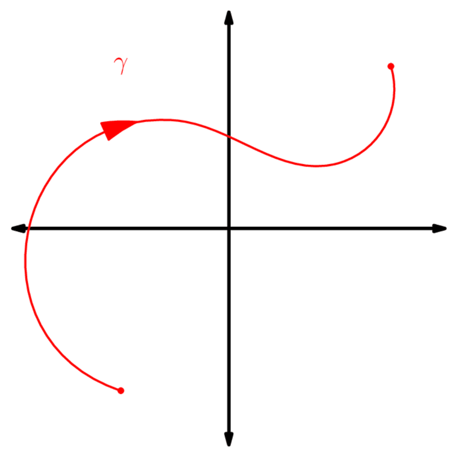

- This thingy is a different path because it's going the other way, so we call it $-\gamma$.

  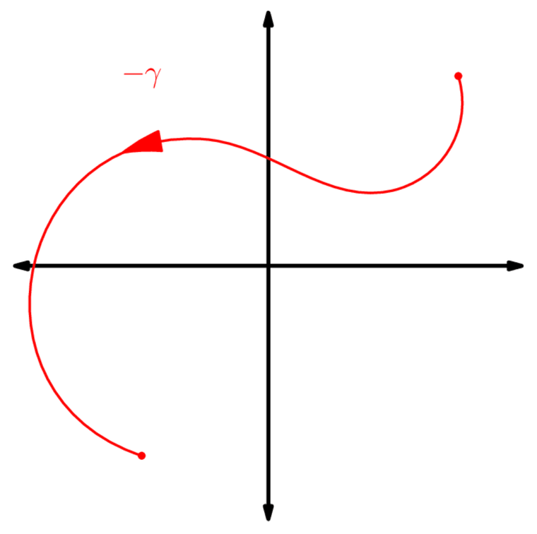

- This is a totally different path, so we're giving it a different letter.

  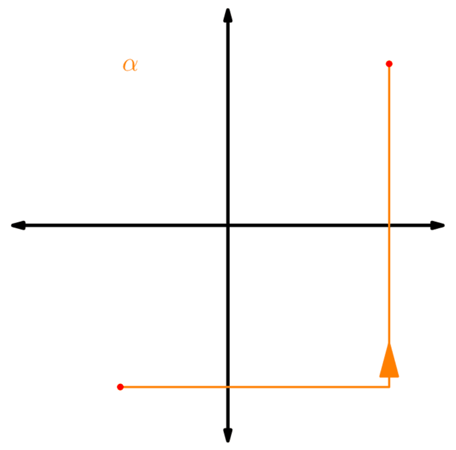

- The unit circle is an important example of a path that loops.

  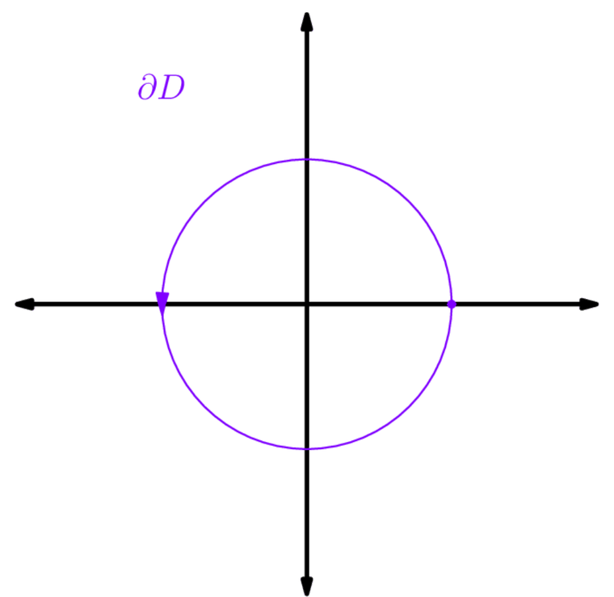

  One way to denote this path is by $\partial D$. Whenever we talk about the unit circle as a path, you should assume that we're going counter-clockwise. (The starting point doesn't really matter.)

- It's ok for paths to have sharp corners. This sector boundary is a perfectly good path! (It also loops)

  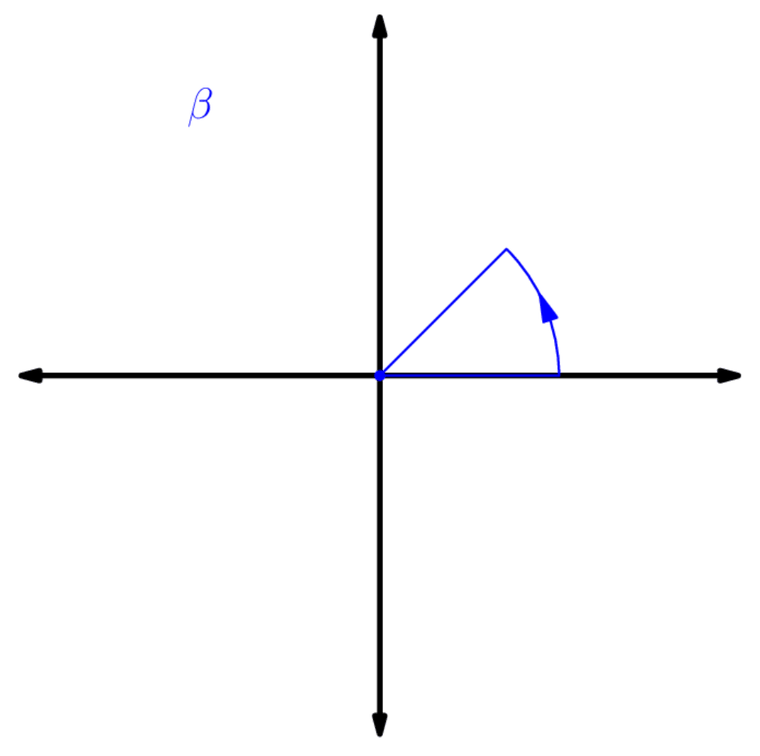

How do you integrate over a path? Here are the steps.

1. Let's say the path is called $\gamma$. First, find a *parametrization* for $\gamma$. A parametrization is a function $\varphi(t)$ that traces out the $\gamma$ path. For example, if $\gamma$ is the unit circle, a parametrization is given by $e^{it}$ as $t$ ranges from $0$ to $2\pi$.
2. Once you have a parametrization $\varphi : [a, b] \to \C$ for $\gamma$, the contour integral is given by

   $$\int_\gamma f(z) \, dz := \int_a^b f(\varphi(t))\varphi'(t) \, dt.$$

It's important that you know how to do this, so let's do three examples.

### Example 1

Let's compute the contour integral $\displaystyle\int_{\partial D} \frac{1}{z} \, dz$, where $\partial D$ is the unit circle oriented counter-clockwise.

A parametrization for $\partial D$ is the function $e^{it}$ as $t$ ranges from $0$ to $2\pi$. Thus the integral is just

$$\int_{\partial D} \frac{1}{z} \, dz = \int_0^{2\pi} \frac{1}{e^{it}} \cdot \left(\frac{d}{dt}e^{it}\right) dt = \int_0^{2\pi} \frac{ie^{it}}{e^{it}} \, dt = \int_0^{2\pi} i \, dt = \boxed{2\pi i}.$$

### Example 2

Let's try a more annoying example. Compute the contour integral $\displaystyle\int_\Gamma \frac{1}{z} \, dz$, where $\Gamma$ is the square with vertices $\pm 1 \pm i$, oriented counter-clockwise.

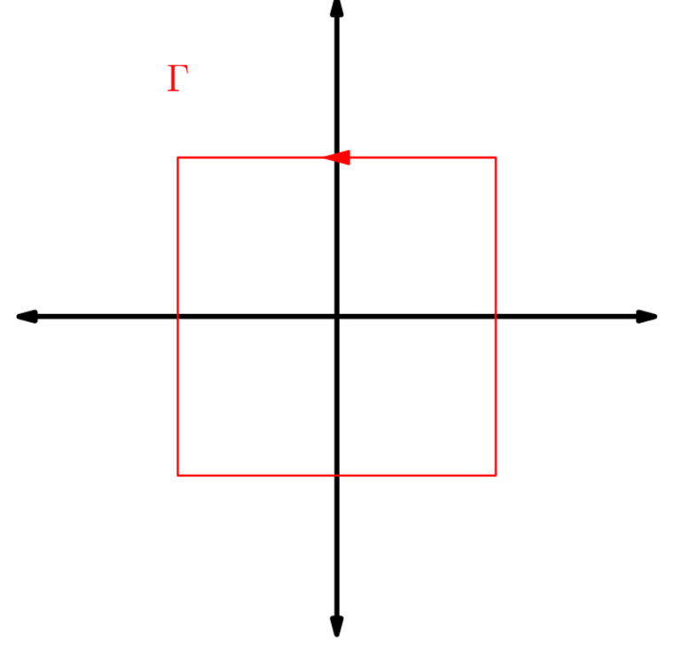

Man, it's annoying to make a single function that traces out the entire square! Fortunately, because of properties of contour integrals, we're allowed to split this path up into four nicer paths, which are each easier to parametrize. Here, I want to split this up into the four segments that make up the square.

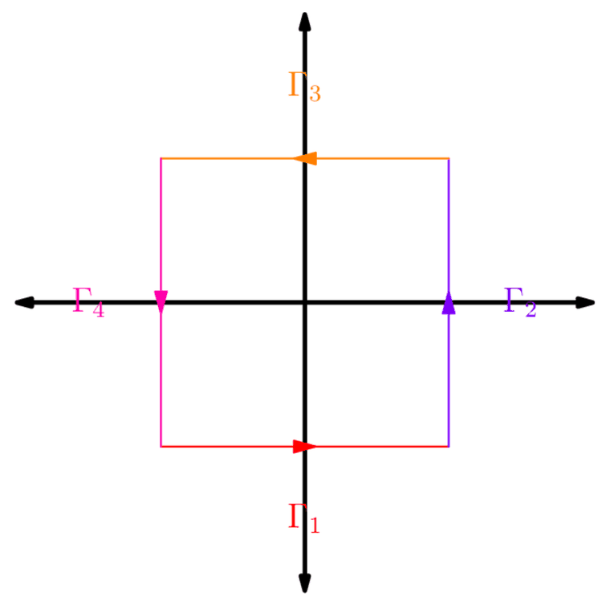

I'm allowed to split up the contour integral into the sum of four smaller contour integrals over these smaller paths:

$$\int_\Gamma \frac{1}{z} \, dz = \int_{\Gamma_1} \frac{1}{z} \, dz + \int_{\Gamma_2} \frac{1}{z} \, dz + \int_{\Gamma_3} \frac{1}{z} \, dz + \int_{\Gamma_4} \frac{1}{z} \, dz$$

So we just need to compute these four integrals. (Yeah yeah yeah it's still annoying, but what can you do...)

- The lower side $\Gamma_1$ can be parametrized by the function $t - i$ as $t$ ranges from $-1$ to $1$. So

  $$\int_{\Gamma_1} \frac{1}{z} \, dz = \int_{-1}^1 \frac{1}{t-i} \cdot \left(\frac{d}{dt}t - i\right) dt = \int_{-1}^1 \frac{1}{t-i} \, dt$$

  Being wary of the warning at the end of Lesson 2, we will NOT be using the complex (principal) log to quickly evaluate this. (Here it should work fine, but I want to be veerrryyyy careful, and so should you!) Let's find a different way to evaluate this.

  Remember: If you are ever nervous about what things you're allowed to do with complex integrals, you can always sidestep the issue by splitting the integral into the real part and the imaginary part. **This is ALWAYS ok.** Here, we can do this by multiplying by the conjugate:

  $$\int_{-1}^1 \frac{1}{t-i} \, dt = \int_{-1}^1 \frac{t+i}{(t-i)(t+i)} \, dt = \int_{-1}^1 \frac{t+i}{t^2+1} \, dt = \int_{-1}^1 \frac{t}{t^2+1} \, dt + i\int_{-1}^1 \frac{1}{t^2+1} \, dt.$$

  The first integral evaluates to $0$ by symmetry (the integrand is odd), and the second integral is $i\tan^{-1}(t)\Big|_{t=-1}^{1} = i\pi/2$. Thus

  $$\int_{\Gamma_1} \frac{1}{z} \, dz = i\pi/2.$$

- The right side $\Gamma_2$ can be parametrized by the function $1 + it$ as $t$ ranges from $-1$ to $1$. So

  $$\int_{\Gamma_2} \frac{1}{z} \, dz = \int_{-1}^1 \frac{1}{1+it} \cdot \left(\frac{d}{dt}1+it\right) dt = i\int_{-1}^1 \frac{1}{1+it} \, dt.$$

  If you do the same trick as we did for $\Gamma_1$, you get that $\displaystyle\int_{\Gamma_2} \frac{1}{z} \, dz = i\pi/2$. Again.
- $\Gamma_3$ is parametrized by $-t + i$, $t \in [-1, 1]$ and we get $\displaystyle\int_{\Gamma_3} \frac{1}{z} \, dz = i\pi/2$ by the same process.
- $\displaystyle\int_{\Gamma_4} \frac{1}{z} \, dz = i\pi/2$ by the same process.

Thus $\displaystyle\int_\Gamma \frac{1}{z} \, dz = i\pi/2 + i\pi/2 + i\pi/2 + i\pi/2 = \boxed{2i\pi}$. Wait, isn't that the same answer as the previous example? Strange.

### Example 3, Kinda

Let's compute the contour integral $\displaystyle\int_\gamma e^z \, dz$, where $\gamma$ is the following pacman shape of radius $1$:

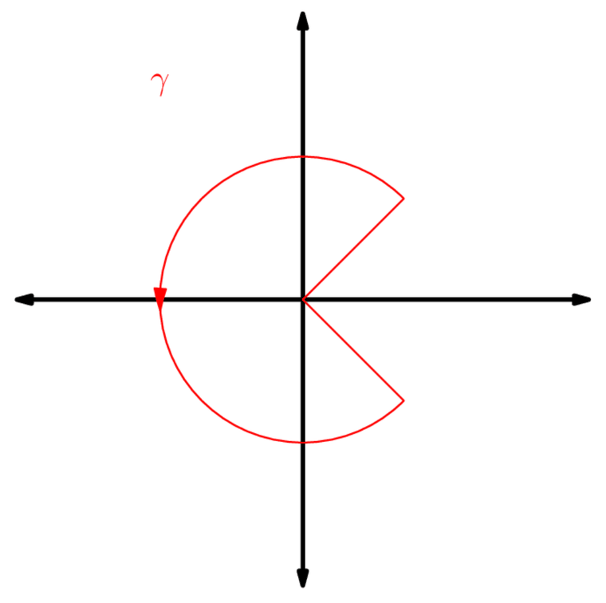

We need to split this into three different parts.

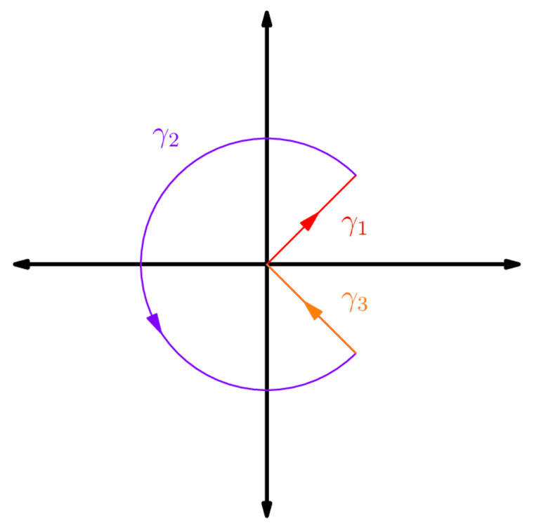

The first part, $\gamma_1$, is parametrized by $e^{i\pi/4}t$ for $t \in [0, 1]$. So the integral over $\gamma_1$ is

$$\begin{aligned}
\int_{\gamma_1} e^z \, dz &= \int_0^1 e^{e^{i\pi/4}t} \cdot \left(\frac{d}{dt}e^{i\pi/4}t\right) dt \\
&= \int_0^1 e^{e^{i\pi/4}t} \cdot e^{i\pi/4} \, dt = e^{i\pi/4}\int_0^1 e^{e^{i\pi/4}t} \, dt.
\end{aligned}$$

This might look complicated, but the integrand is basically just of the form $e^{ct}$ where $c$ is a constant. So its antiderivative is $c^{-1}e^{ct}$, meaning that this integral evaluates to

$$e^{i\pi/4}\int_0^1 e^{e^{i\pi/4}t} \, dt = e^{e^{i\pi/4}t}\Big|_{t=0}^{1} = e^{e^{i\pi/4}} - 1.$$

The third part, $\gamma_3$, is handled similarly. It runs from $e^{-i\pi/4}$ back into the origin, so we parametrize it by $e^{-i\pi/4}(1-t)$ for $t \in [0, 1]$:

$$\int_{\gamma_3} e^z \, dz = \int_0^1 e^{e^{-i\pi/4}(1-t)} \cdot \left(\frac{d}{dt}e^{-i\pi/4}(1-t)\right) dt = \cdots = 1 - e^{e^{-i\pi/4}}$$

Now we tackle the second part, $\gamma_2$. This is parametrized by $e^{it}$ for $t \in [\pi/4, 7\pi/4]$. So

$$\int_{\gamma_2} e^z \, dz = \int_{\pi/4}^{7\pi/4} e^{e^{it}} \cdot \left(\frac{d}{dt}e^{it}\right) dt = \int_{\pi/4}^{7\pi/4} e^{e^{it}} \cdot ie^{it} \, dt.$$

This integral sucks to evaluate, so I'm not going to do it. (note that making the "substitution" $u = e^{it}$ doesn't actually help you because it just goes backwards a step.)

Darn, if only there was some really cool theorem that could help solve this problem. What a shame.

*Summary of Contour Integral Properties*

- It's linear, so $\displaystyle\int_\gamma f(z) + g(z) \, dz = \int_\gamma f(z) \, dz + \int_\gamma g(z) \, dz$, and also $\displaystyle\int_\gamma c \cdot f(z) \, dz = c\int_\gamma f(z) \, dz$.
- It's "additive on paths". So if you split a path $\gamma$ into two paths $\gamma_1$ and $\gamma_2$, then $\displaystyle\int_\gamma f(z) \, dz = \int_{\gamma_1} f(z) \, dz + \int_{\gamma_2} f(z) \, dz$. We used this property to do Example 2.
- Reversing the direction of the path will negate the integral. That is, if $\gamma$ is a path and $-\gamma$ is that same path but going the opposite way, then $\displaystyle\int_{-\gamma} f(z) \, dz = -\int_\gamma f(z) \, dz$.

(*Stupid warning: If you're intentionally trying to break math, it's possible to take contour integrals over really strange paths that completely destroy this post. It's basically impossible for you to do that unless you try though, because those paths that might do that are REALLY nasty and hard to come up with, so don't worry.*)

*Exercises*

::: exercise
Let $\log$ denote the principal logarithm, so that $\log(re^{i\theta}) = \log(r) + i\theta$ whenever $r > 0$ and $\theta \in (-\pi, \pi)$. Demonstrate the identity

$$\log(re^{i\theta}) = \int_\gamma \frac{1}{z} \, dz,$$

where $\gamma$ is the path that starts at $1$, moves left/right to the real number $r$, then moves along a $\theta$-radian arc centered at $0$ with radius $r$ in order to reach the complex number $re^{i\theta}$.

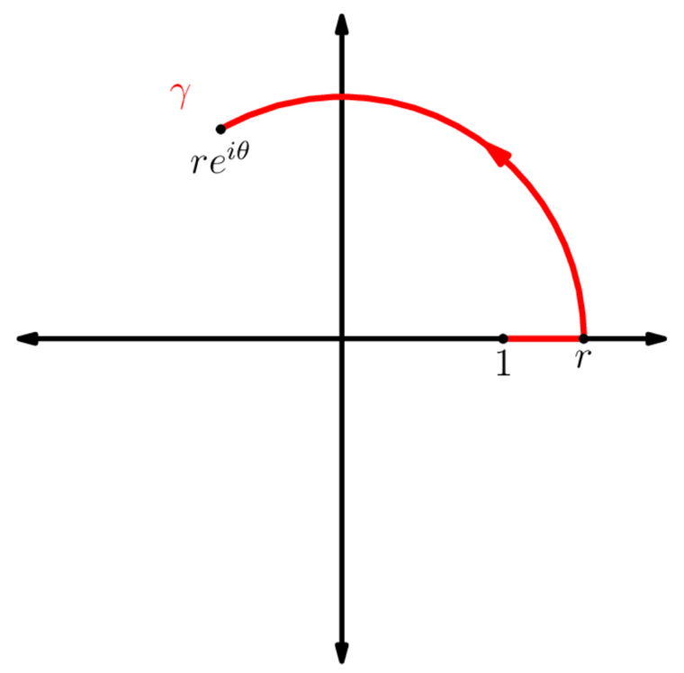

(If you want, you may assume that $r > 1$ and $\theta > 0$ so you don't have to consider multiple cases.)

Solution

Naturally, we split this path into the two obvious parts.

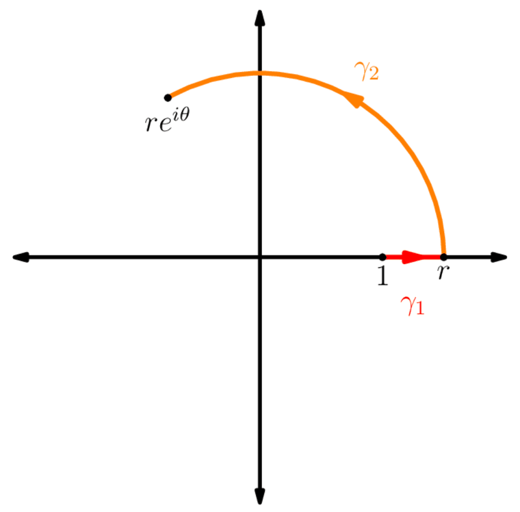

The first part, $\gamma_1$, is parametrized by $t$ for $t \in [1, r]$, so we have that

$$\int_{\gamma_1} \frac{1}{z} \, dz = \int_1^r \frac{1}{t} \, dt = \log r.$$

The second part, $\gamma_2$, is parametrized by $re^{it}$ for $t \in [0, \theta]$, so we have that

$$\int_{\gamma_2} \frac{1}{z} \, dz = \int_0^\theta \frac{1}{re^{it}} \cdot \left(\frac{d}{dt}re^{it}\right) dt = \int_0^\theta \frac{1}{re^{it}} \cdot ire^{it} \, dt = \int_0^\theta i \, dt = i\theta.$$

In sum,

$$\int_\gamma \frac{1}{z} \, dz = \int_{\gamma_1} \frac{1}{z} \, dz + \int_{\gamma_2} \frac{1}{z} \, dz = \log r + i\theta.$$

:::

## Lesson 4: Holomorphic Functions

In the complex world, "holomorphic" is just a fancy word for "differentiable". All of the functions we've mentioned so far are holomorphic:

- Polynomials like $z^n + z^2 - z + 3$ are holomorphic, over all $z \in \C$.
- $e^z$ is holomorphic, over all $z \in \C$.
- $\cos z$ is holomorphic, over all $z \in \C$.
- Rational functions such as $1/z$ or $\dfrac{1}{z^2+1}$ are holomorphic, wherever they are defined.
- Combining things from above (using addition, multiplication, composition, etc.) will still make a holomorphic function. For example, $\sin(z^2) - 1/\cos(e^z)$ is holomorphic, wherever it is defined.

If you want more fancy words: A function that is holomorphic on the whole complex plane is called *entire*.

Some functions are a bit more subtle.

- The principal square root $\sqrt{z}$ is holomorphic wherever it is defined, **because I excluded the negative reals in the definition**. If you define the square root over the negative reals, then it won't be holomorphic... or even continuous! This is why it's so important to restrict the principal square root to the *slit plane* $\C \setminus \{x \in \R : x \leq 0\}$.
- The principal log $\log z$ is holomorphic for the same reason. Its derivative is $1/z$ (with domain being the slit plane).

Not everything is holomorphic.

- Unsurprising Counterexample: $|z|$ is not holomorphic. It has a "sharp corner" at $0$. (In fact it fails to be holomorphic at every point, but the corner is the obvious culprit.)
- Surprising Counterexample: $\overline{z}$ is not holomorphic! Very roughly speaking, this is because conjugation messes up rotations.

(*Holomorphic functions satisfy some really insanely cool properties. They're honestly miracles. We won't really talk about these miracles, though, since that would make this post longer than it needs to be.*)

Here is the motto I want you to take away from this lesson: Holomorphic functions are really nice, and you should not try and apply any of the theorems we talk about to functions that are not holomorphic. I can't guarantee that the numbers will work out if you do that. Fortunately, basically all sane things that you would consider integrating are holomorphic!

## Lesson 5: Cauchy's Theorem

So here's a CRAZY fact.

::: theorem Cauchy
Suppose $f$ is a holomorphic function. Suppose $\gamma$ is a path that loops. If $f$ is defined everywhere inside the loop, then

$$\int_\gamma f(z) \, dz = 0.$$
:::

### Example 1

What is $\displaystyle\int_{\partial D} \sin(e^z) + e^{e^{e^z}} - e^{\cos(z^2)} \, dz$? Remember that $\partial D$ is the unit circle oriented counter-clockwise. Well, the integrand is holomorphic, and it's defined on the entire plane (so it's defined inside the unit circle). Since the unit circle loops, the answer to this integral must be $\boxed{0}$.

### Example 2

What is $\displaystyle\int_\gamma \cos(\cos(\cos(\cos(\cos(z))))) \, dz$, where $\gamma$ is the following curve?

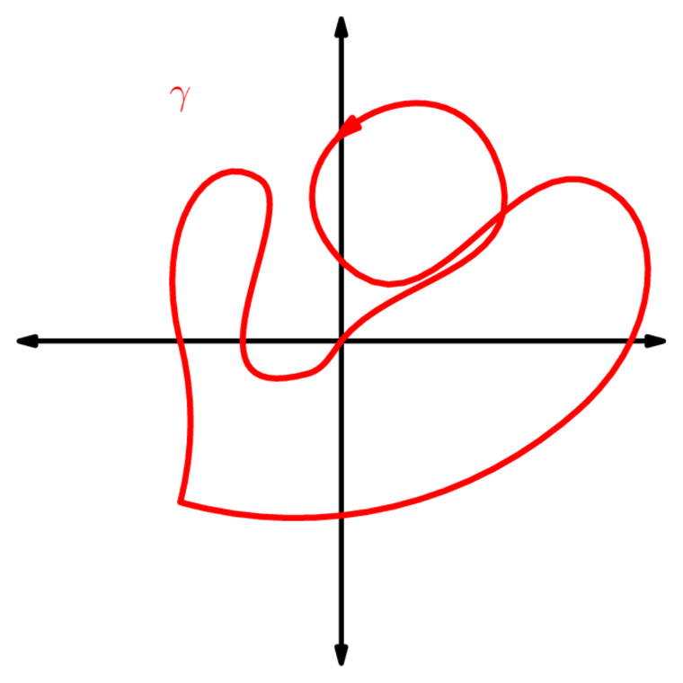

Well, the integrand is holomorphic, defined everywhere, and the path loops, so it's $\boxed{0}$.

### Example 3

Remember that annoying pacman integral $\displaystyle\int_\gamma e^z \, dz$?

Well, $e^z$ is very holomorphic, is defined everywhere, and the path loops, so without needing to do any annoying computations I can say that the integral is $\boxed{0}$.

### Non-Example 1

It is not true that $\displaystyle\int_{\partial D} \overline{z} \, dz = 0$. In fact, if we work it out

$$\int_{\partial D} \overline{z} \, dz = \int_0^{2\pi} \overline{e^{it}} \cdot ie^{it} \, dt = \int_0^{2\pi} e^{-it} \cdot ie^{it} \, dt = \int_0^{2\pi} i \, dt = 2\pi i,$$

this integral will be equal to $2\pi i$.

That's strange. $\partial D$ is just a circle, so it definitely loops... and $\overline{z}$ is defined inside the circle too. What went wrong? Can you figure it out? The reason is that...

Show the reason

$\overline{z}$ is not holomorphic! That's why I needed to talk about holomorphic functions, so you don't try and apply the theorems we discuss to bad functions like $\overline{z}$. The last thing I want is for you to try something like that, and then think that math is broken!

### Non-Example 2

It is not true that $\displaystyle\int_{\partial D} \frac{1}{z} \, dz = 0$. In fact, if we work it out

$$\int_{\partial D} z^{-1} \, dz = \int_0^{2\pi} e^{-it} \cdot ie^{it} \, dt = \int_0^{2\pi} i \, dt = 2\pi i,$$

this integral will be equal to $2\pi i$.

Huh? $\partial D$ is a looping path, and $\dfrac{1}{z}$ is holomorphic wherever it is defined. What went wrong this time? The reason is that...

Show the reason

$1/z$ is not defined everywhere inside the circle! The number $0$ lies in the interior of the unit circle, and $1/z$ breaks at $z = 0$.

We call $z = 0$ a *singularity* of $1/z$. In particular, it is a *pole* of $1/z$. Because $1/z$ has a pole inside the loop, we cannot apply Cauchy's theorem.

### Example 4

Let $f$ be a holomorphic function that is defined everywhere on $\C$ (i.e. "$f$ is entire"). Let $w_1$ and $w_2$ be two complex numbers, and consider two different paths that start at $w_1$ and end at $w_2$. Call these paths $\alpha$ and $\beta$.

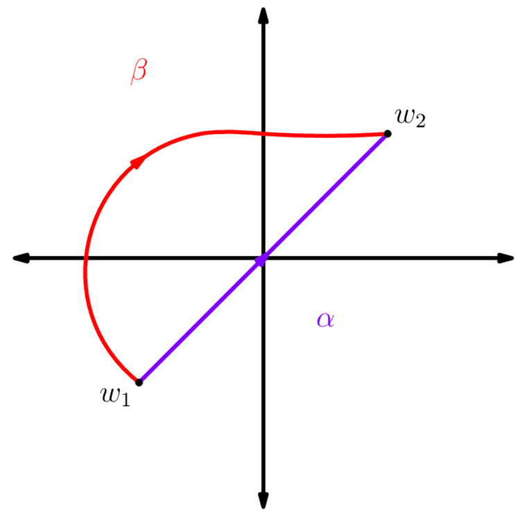

It turns out that $\displaystyle\int_\alpha f(z) \, dz = \int_\beta f(z) \, dz$! This means that the path integral between $w_1$ and $w_2$ is the same, no matter what path you take.

Why is that the case? Let's reverse one of the paths... say, $\beta$.

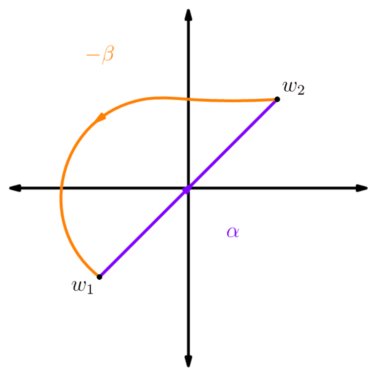

Hey, now that's a loop! So by Cauchy's Theorem,

$$\int_\alpha f(z) \, dz + \int_{-\beta} f(z) \, dz = 0.$$

But remember: Reversing the direction of a path will negate the integral over it. So $\displaystyle\int_{-\beta} f(z) \, dz = -\int_\beta f(z) \, dz$. This means that

$$\int_\alpha f(z) \, dz - \int_\beta f(z) \, dz = 0.$$

So yeah, the integrals are equal!

*Exercises*

::: exercise
Compute the contour integral

$$\int_{\partial D} e^{e^{e^{e^{e^z}}}} \, dz.$$

Answer

It's just $0$.

:::

::: exercise
Remember Lesson 3 Exercise 1? You showed that for any $w \in \C$ that is not zero or a negative real number, we have the identity

$$\int_\gamma \frac{1}{z} \, dz = \log w,$$

where $\gamma$ is some carefully-chosen path from $1$ to $w$.

Prove that, actually, this identity holds no matter what path $\gamma$ we choose from $1$ to $w$ (as long as it doesn't cross the negative real line, where $\log$ would be undefined).

Solution

We use the principle that we learned from Example 4. If $\gamma$ is the carefully-chosen path from the exercise, and $\gamma'$ is some other path from $1$ to $w$, then we want to show that the integrals $\displaystyle\int_\gamma 1/z \, dz$ and $\displaystyle\int_{\gamma'} 1/z \, dz$ are the same.

All we need to show is that if we reverse the path $\gamma'$ to get $-\gamma'$, then the paths $\gamma$ and $-\gamma'$ form a loop that we can apply Cauchy's Theorem to.

Well, $1/z$ is holomorphic over all $z \neq 0$, so the only thing that can go wrong is if the singularity at $z = 0$ is inside the loop formed by $\gamma$ and $-\gamma'$. But this can't happen because neither of these two paths cross the negative real line!

So nothing can go wrong, and so we can apply Cauchy's Theorem to deduce that the two original integrals are indeed equal.

:::

## Lesson 6: Residues

The **Residue Theorem** is basically Cauchy's Theorem but better. To understand it, we need to know how to calculate a function's *residue* at a singularity.

I won't give you the "correct" definition of what a residue is, because that would make this post a lot longer and more complicated. So I'll just tell you how to calculate it in some simple cases.

**General Setting:** A holomorphic function $f$ may not be defined at some complex number $z_0$. But, it would have something called a *residue* at this $z_0$. A prototypical example is the function $1/z$ being not defined at $z = 0$. $1/z$ has no value at $z = 0$, but it has a residue.

**General Idea:** The residue of a function at a certain point tells you how much "spinning" it induces around that point.

**How to calculate the residue in most cases:** If $(z - z_0)f(z)$ is continuous at $z_0$ (meaning, we can "plug in the hole" at $z = z_0$ to make the function $(z - z_0)f(z)$ nice), then the residue is simply

$$\lim_{z \to z_0} (z - z_0)f(z)$$

(i.e. the residue is the number we need to plug into the hole). The residue is denoted by $\displaystyle\operatorname*{Res}_{z=z_0} f(z)$.

This is a very informal definition, so it will make a lot more sense when we try some examples.

### Example 1

$1/z$ is not defined at $z = 0$, but it has a residue there. What is it? To find it, all we need to do is multiply by $(z - 0) = z$ to make the singularity go away. Indeed, when we multiply $1/z$ by $z$, we get $1$, which is nice. The value of $1$ at $z = 0$ is... well, $1$. So the residue is $1$. i.e. $\displaystyle\operatorname*{Res}_{z=0} \frac{1}{z} = 1$.

### Example 2

$\dfrac{1}{\sin z}$ is not defined at $z = 0$, but it has a residue there. What is it? To find it, we need to multiply by $(z - 0) = z$ to try and make the singularity go away. When we multiply $1/\sin z$ by $z$, we get $\dfrac{z}{\sin z}$.

At first glance, it's not clear if we made the singularity go away. But if you took Calculus, you might know that $\displaystyle\lim_{x \to 0} \frac{x}{\sin x} = 1$. The same limit holds in the complex world (and you can verify this by a Taylor expansion

$$\frac{z}{\sin z} = \frac{z}{z - z^3/6 + \cdots} = \frac{1}{1 - z^2/6 + \cdots}$$

and this is $1$ when you plug in $z = 0$). That is, $\displaystyle\lim_{z \to 0} \frac{z}{\sin z} = 1$. The $z$ factor helped make this limit possible! Because of this, the residue is easily found: It is exactly equal to that limit, which is $1$. i.e. $\displaystyle\operatorname*{Res}_{z=0} \frac{1}{\sin z} = 1$.

### Example 3

$\dfrac{1}{z^2+1}$ is not defined at $z = i$, but it has a residue there. What is it? To find it, we need to multiply by $(z - i)$ to make the singularity go away. Indeed,

$$\frac{z-i}{z^2+1} = \frac{z-i}{(z-i)(z+i)} = \frac{1}{z+i}.$$

This new expression has no singularity at $z = i$ anymore! So we successfully got rid of the badness at $z = i$. The residue is then equal to the limit $\displaystyle\lim_{z \to i} \frac{1}{z+i}$. But as I said, this new function is nice at $z = i$, so to evaluate the limit we can just plug in $z = i$ to get $\dfrac{1}{2i}$. This is the residue! And we can write $\displaystyle\operatorname*{Res}_{z=i} \frac{1}{z^2+1} = \frac{1}{2i}$.

### Non-Example

$1/z^2$ is not defined at $z = 0$, but it has a residue there. What is it? To try and find it, we could multiply by $z - 0 = z$ to get $1/z$. But this doesn't remove the singularity because $1/z$ is still bad at $z = 0$. Oops!

That means that the easy method I gave you doesn't work here. It turns out that $\displaystyle\operatorname*{Res}_{z=0} \frac{1}{z^2} = 0$, for reasons that I will explain below.

*Wait so what is the residue, actually? And how do I find the residue of higher-order poles, like in $1/z^2$?*

To ease optional eyestrain, I'm going to put this in spoilers.

The Methodology and Rough Motivation

So, functions like $\dfrac{1}{\sin^2 z}$ are not that nice. But they're a quotient of two nice (i.e. holomorphic) functions. Because of this, we call such functions *meromorphic*, more or less. It turns out that functions like these always have a "two-sided Taylor series", meaning that the series can include negative-integer-exponent terms like $1/z$ or $1/z^2$ to account for the "badness" at singularities. For example, the series expansion of $1/\sin z$ at $z = 0$ is

$$\frac{1}{\sin z} = \frac{1}{z} + \frac{z}{6} + \frac{7z^3}{360} + \frac{31z^5}{15120} + \cdots,$$

and the series expansion of $1/\sin^2 z$ at $z = 0$ is given by

$$\frac{1}{\sin^2 z} = \frac{1}{z^2} + \frac{1}{3} + \frac{z^2}{15} + \frac{2z^4}{189} + \cdots.$$

**The coefficient of the $1/z$ term is the residue.** (More generally, when the pole is at $z_0$, then the residue is the coefficient of $1/(z - z_0)$ in the series expansion around $z_0$.) Intuitively, we look at this term because it is the only term that gives you a non-zero result when you compute its contour integral over a path that loops around $0$. So it is the only term that induces "spin".

For example, from the series above, we can see that $\displaystyle\operatorname*{Res}_{z=0} \frac{1}{\sin z} = 1$ (as we saw earlier!), and that $\displaystyle\operatorname*{Res}_{z=0} \frac{1}{\sin^2 z} = 0$.

What is $\displaystyle\operatorname*{Res}_{z=0} \frac{1}{z^2}$? Well, the series for $1/z^2$ is

$$\frac{1}{z^2} = \frac{1}{z^2} + \frac{0}{z} + 0 + 0z + 0z^2 + \cdots,$$

so the residue is the coefficient of $1/z$ in this series, which is $0$.

There is a formula for finding the residue of things like $1/\sin^2 z$ that have "higher-order poles". It's a two step process.

To find $\displaystyle\operatorname*{Res}_{z=z_0} f(z)$...

1. First, find the smallest natural number $n$ for which $(z - z_0)^n f(z)$ becomes nice, so that the singularity is basically gone.
2. Then, the residue is given by this formula:

   $$\operatorname*{Res}_{z=z_0} f(z) = \frac{1}{(n-1)!}\lim_{z \to z_0} \frac{d^{n-1}}{dz^{n-1}}\left[(z - z_0)^n f(z)\right]$$

As nasty as it is, it kinda makes sense. Multiplying by $(z - z_0)^n$ shifts the terms in the series *just enough* so that all the terms have positive exponents. Then, differentiating $n-1$ times shifts it back the other way, but also kills all low-order terms... except for that one term (the one that used to be the $1/(z - z_0)$ term) that we need! In fact, after we're done taking derivatives, the constant term will be $(n-1)!$ multiplied by what used to be the coefficient of $1/(z - z_0)$. Sending $z \to z_0$ gets rid of all the other terms, leaving us with just the residue... alone!

*Exercises*

::: exercise
Compute $\displaystyle\operatorname*{Res}_{z=42} \frac{\log z}{z - 42}$.

Solution

Multiplying by $(z - 42)$ removes the singularity at $42$, leaving us with $\log z$, and indeed this is nice at $z = 42$. Plugging in $z = 42$ gives

$$\boxed{\operatorname*{Res}_{z=42} \frac{\log z}{z - 42} = \log 42}.$$

:::

::: exercise
Compute $\displaystyle\operatorname*{Res}_{z=i} \frac{1}{z^4 - 1}$.

Solution

We write $\dfrac{1}{z^4-1} = \dfrac{1}{(z-1)(z+1)(z+i)(z-i)}$. Now we remove the singularity by multiplying by $(z - i)$. This leaves us with $\dfrac{1}{(z-1)(z+1)(z+i)}$, which is now indeed nice at $z = i$. Plugging in $z = i$ gives

$$\boxed{\operatorname*{Res}_{z=i} \frac{1}{z^4-1} = \frac{1}{(i-1)(i+1)(i+i)}}.$$

Whatever that is.

:::

::: exercise
(Using the Ugly Formula) Compute $\displaystyle\operatorname*{Res}_{z=1} \frac{\log z}{(z-1)^3}$.

Solution

First step: How many times do we need to multiply by $(z - 1)$ so that the function becomes nice at $z = 1$? At first glance, it might seem like you want to do it three times so that it becomes $\log z$, and this is definitely nice at $z = 1$. But actually, just two times is enough! This is because $\log z$ has a zero at $z = 1$.

How can we verify that $\dfrac{\log z}{z-1}$ is nice at $z = 1$? Meaning, does this have a limit when we send $z \to 1$? One way to do this is using the Taylor series for $\log(1-z)$. We can write

$$\log z = \log(1 - (1-z)) = -(1-z) - \frac{(1-z)^2}{2} - \frac{(1-z)^3}{3} - \cdots,$$

so that

$$\frac{\log z}{z-1} = 1 - \frac{z-1}{2} + \frac{(z-1)^2}{3} - \cdots.$$

This clearly does not explode at $z = 1$, so this proves that $\dfrac{\log z}{z-1}$ is continuous at $z = 1$.

So $n = 2$ is the power we need.

Second step: We now have to use the formula. $(z-1)^2 \cdot f(z)$ is just $\dfrac{\log z}{z-1}$.

Now we differentiate this $2 - 1 = 1$ times. By the quotient rule, this is equal to

$$\frac{\frac{z-1}{z} - \log z}{(z-1)^2}.$$

Now we need to take the limit of this as $z \to 1$. Blegh. Let's first make a substitution $w = z - 1$. This will make things a bit simpler to write.

$$\lim_{z \to 1} \frac{\frac{z-1}{z} - \log z}{(z-1)^2} = \lim_{w \to 0} \frac{\frac{w}{1+w} - \log(1+w)}{w^2} = \lim_{w \to 0} \frac{w - (1+w)\log(1+w)}{(1+w)w^2}$$

We can find this limit using the Taylor expansion for $\log(1+w)$. The expression is equal to

$$\frac{w - (1+w)(w - w^2/2 + \text{blah})}{(1+w)w^2} = \frac{-w^2/2 + \text{blahblah}}{(1+w)w^2} = \frac{-1}{2(1+w)} + \text{blahblahblah}.$$

The "blah" terms go to $0$ fast enough so that we can ignore them (I'm not being very rigorous). So if we send $w \to 0$ here, we get

$$\boxed{\operatorname*{Res}_{z=1} \frac{\log z}{(z-1)^3} = \frac{-1}{2}}.$$

:::

## Lesson 7: The Residue Theorem

We're finally here.

The Residue Theorem gives us a very simple way to evaluate basically any contour integral!

To reduce complexity, the theorem will only be for "simple loops", which are basically loops that don't intersect themselves. (So circles are good, but figure-8's are not.)

::: theorem Residue Theorem
Let $\gamma$ be a simple looping path, which loops in the counter-clockwise direction. Let $f$ be a holomorphic (meromorphic) function that is not defined (i.e. has a "pole") at some points $z_1, z_2, \cdots, z_k$ inside the loop. Then

$$\int_\gamma f(z) \, dz = 2\pi i\sum_{j=1}^k \operatorname*{Res}_{z=z_j} f(z).$$
:::

In other words, the contour integral is just $2\pi i$ times the sum of all residues inside the loop.

### Example 1

Let us return to this classic example of integrating $1/z$ around the unit circle.

$$\int_{\partial D} \frac{1}{z} \, dz$$

There is exactly one point in the interior of the circle where $1/z$ explodes, and that is $z = 0$. The residue of $1/z$ at $z = 0$, as we saw before, is $1$. Thus we may apply the Residue Theorem to get

$$\int_{\partial D} \frac{1}{z} \, dz = 2\pi i \times \operatorname*{Res}_{z=0} \frac{1}{z} = \boxed{2\pi i}.$$

### Example 2

Let us return to Lesson 3 Example 2, where we once again integrate $1/z$, but this time around a square.

What is $\displaystyle\int_\Gamma \frac{1}{z} \, dz$? Again, there is only one place inside this square where the integrand explodes: $z = 0$. The residue there has not changed: It's still $1$. So $\displaystyle\int_\Gamma \frac{1}{z} \, dz = \boxed{2\pi i}$, just like in the previous example.

This shows that the integral of $1/z$ around *any* path that loops around $0$ will be $2\pi i$. (As long as you loop only once, and you loop in the counter-clockwise direction.)

### Example 3

Let $\gamma$ be a (simple) loop oriented counter-clockwise. Let $f$ be a holomorphic function that is defined everywhere in the interior of this loop.

Then the sum of the residues inside the loop is... well, $0$, because there are no singularities to deal with (and hence no residues to sum up). So $\displaystyle\int_\gamma f(z) \, dz = 0$. This is Cauchy's Theorem.

### Example 4

Let $\partial D(r)$ be the circle centered at $0$ of radius $r$, oriented counter-clockwise. When $r \neq 1$, what are the possible values of the integral

$$\int_{\partial D(r)} \frac{1}{z + 1/z} \, dz ?$$

First let us write it as

$$\int_{\partial D(r)} \frac{z}{z^2+1} \, dz = \int_{\partial D(r)} \frac{z}{(z+i)(z-i)} \, dz.$$

This tells us that the integrand explodes at only two points: $z = i$ and $z = -i$.

First case: If $0 < r < 1$, then the interior of the disk of radius $r$ won't contain either $i$ or $-i$, meaning that the integrand is defined everywhere inside it. So by Cauchy's Theorem, we would get $\displaystyle\int_{\partial D(r)} \frac{z}{z^2+1} \, dz = 0$.

Second case: If $r > 1$, then the interior of the disk of radius $r$ will contain *both* $i$ and $-i$. We need to sum up the residues at both of these singularities.

For $z = i$, we multiply the integrand by $z - i$ to get $\dfrac{z}{z+i}$. Plugging in $z = i$ into this will give us $\dfrac{i}{2i} = \dfrac{1}{2}$, so $\displaystyle\operatorname*{Res}_{z=i} \frac{z}{z^2+1} = \frac{1}{2}$.

For $z = -i$, we instead multiply by $z + i$ to get $\dfrac{z}{z-i}$. Plugging in $z = -i$ gives $\dfrac{-i}{-2i} = \dfrac{1}{2}$, so $\displaystyle\operatorname*{Res}_{z=-i} \frac{z}{z^2+1} = \frac{1}{2}$.

Therefore, by the Residue Theorem,

$$\int_{\partial D(r)} \frac{z}{z^2+1} \, dz = 2\pi i\left(\operatorname*{Res}_{z=i} \frac{z}{z^2+1} + \operatorname*{Res}_{z=-i} \frac{z}{z^2+1}\right) = 2\pi i(1/2 + 1/2) = 2\pi i.$$

The two possible values are $\boxed{0}$ and $\boxed{2\pi i}$.

*Exercises*

::: exercise
Compute $\displaystyle\int_{\partial D} \frac{1}{\sin z} \, dz$.

Answer

$2\pi i$

:::

::: exercise
Compute $\displaystyle\int_{\partial D(\pi + 0.001)} \frac{1}{\sin z} \, dz$. (Careful!)

Answer

$-2\pi i$

Solution

There are actually **three** singularities you need to worry about: $-\pi$, $0$, and $\pi$. Since $\displaystyle\lim_{z \to \pi} \frac{z - \pi}{\sin z} = -1$, we have $\displaystyle\operatorname*{Res}_{z=\pi} \frac{1}{\sin z} = -1$, and similarly for $-\pi$. The integral is then $2\pi i(-1 + 1 - 1) = -2\pi i$.

:::

::: exercise
Compute $\displaystyle\int_\gamma \frac{e^z}{z^4 - 1} \, dz$, where $\gamma$ is the rectangle with vertices $\pm 100 \pm 0.5i$, oriented counter-clockwise.

Solution

The singularities are $z = -1, 1, i, -i$. But only two of them lie inside the interior of the looping rectangle: $-1$ and $1$.

The residue at $1$ is just $\dfrac{e^z}{(z+1)(z+i)(z-i)}$ evaluated at $z = 1$, which is $\dfrac{e^1}{2(1+i)(1-i)} = \dfrac{e}{4}$.

The residue at $-1$ is just $\dfrac{e^z}{(z-1)(z+i)(z-i)}$ evaluated at $z = -1$, which is $\dfrac{e^{-1}}{-2(-1+i)(-1-i)} = \dfrac{1}{-4e}$.

By the Residue Theorem, we conclude that

$$\int_\gamma \frac{e^z}{z^4-1} \, dz = \boxed{2\pi i\left(\frac{e}{4} - \frac{1}{4e}\right)}.$$

:::

## Lesson 8: Finally, we can have some fun!

We have been stuck in complex land for 7 (8?) lessons. It's time to wake up and get back to reality.

### Example 1

If you've taken calculus, you probably know how to evaluate the integral

$$\int_{-\infty}^\infty \frac{1}{1+x^2} \, dx$$

by using the fact that $\arctan(x)$ is an antiderivative for the integrand. But what if we didn't know that? It turns out that we can evaluate this integral using the power of complex numbers. Specifically, we will use contour integration. The techniques are difficult to explain without example, so we will walk through how to evaluate this integral so that you learn these techniques along the way.

The first issue we face is that the limits $-\infty$ and $+\infty$ are unwieldy for applying any techniques we've learned. Here is how we fix that.

**Key Idea 1:** *Indefinite integrals are really just limits of definite integrals.*

Instead of examining $\displaystyle\int_{-\infty}^\infty \frac{1}{1+x^2} \, dx$, we can study $\displaystyle\int_{-R}^R \frac{1}{1+x^2} \, dx$ where $R > 0$ is a large number. We'll play with this definite integral, and then eventually we will send $R \to +\infty$. Sound like a plan?

Great, but how do complex numbers possibly relate to evaluating $\displaystyle\int_{-R}^R \frac{1}{1+x^2} \, dx$?

**Key Idea 2:** *Integrals over the real line are just integrals over the real-axis path!*

Aha! We can reinterpret this integral as a path integral $\displaystyle\int_{\gamma_1} \frac{1}{1+z^2} \, dz$ in the complex plane, where $\gamma_1$ is the straight line segment between $-R$ and $R$.

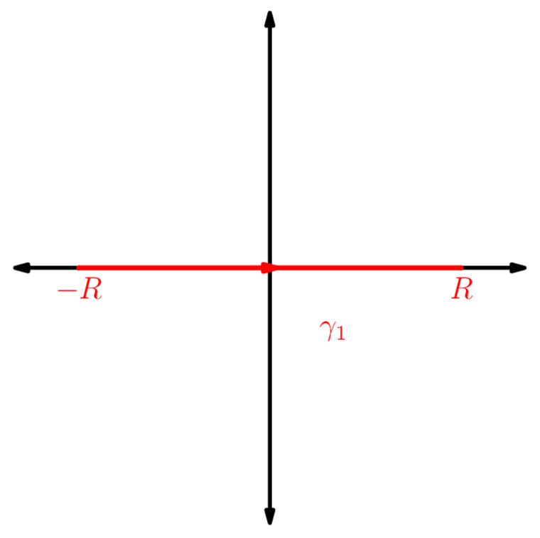

Why is this ok?

This path is parametrized by $t$ where $t \in (-R, R)$. Then, by definition of integrating over paths, we have:

$$\int_{\gamma_1} \frac{1}{1+z^2} \, dz = \int_{-R}^R \frac{1}{1+t^2} \cdot \left(\frac{d}{dt}t\right) dt = \int_{-R}^R \frac{1}{1+t^2} \, dt,$$

which is exactly the integral we are trying to study!

Nice! Now we're kinda in complex land... though, we haven't *really* used complex numbers yet, we kinda just reframed the problem. What can we use now?

**Key Idea 3:** *Close the loop so that we can apply Cauchy's Theorem and/or the Residue Theorem!*

Ah! The path we have right now is just a segment. It's not a loop yet, so we can't apply the powerful theorems we've been learning. So we need to *close the loop* by drawing a path from $R$ back to $-R$.

What kind of path should we draw? **This step is usually the tricky part.** It takes some experience and practice to choose the correct contour. Here, it turns out that it doesn't matter too much, as long as it's reasonable. So we'll choose the most natural path: *A semicircle!*

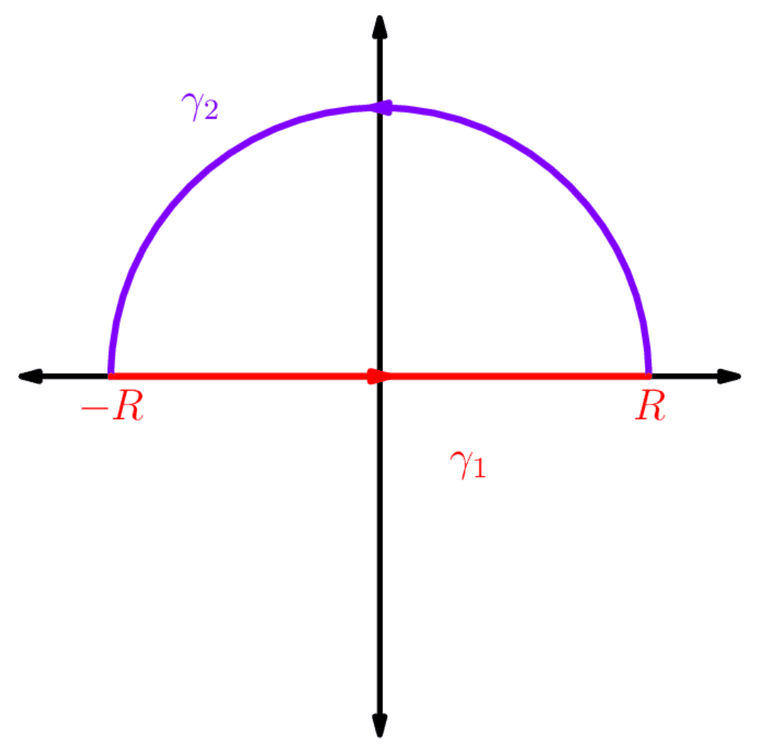

On one hand, this makes the path a loop, and now we can apply the Residue Theorem! Yay! On the other hand, this means that there is another part of the path that we need to integrate over. Wouldn't that mess up our computation? What do semicircles have to do with anything? This should be concerning.

It turns out that the semicircle part of the loop doesn't matter in the long run: It will "vanish" when we send $R \to +\infty$, which is why this is ok. I'll explain why it vanishes soon, but roughly speaking it vanishes because $\dfrac{1}{1+z^2}$ gets really small when $z$ is very far away from $0$, and integrating a smaller and smaller expression gets you a smaller and smaller result.

Enough dilly-dallying! Let's start by writing an expression for the contour integral over this whole loop, which we shall call $\gamma$.

The first part is the bottom part, $\gamma_1$. Well, we already know that $\displaystyle\int_{\gamma_1} \frac{1}{1+z^2} \, dz$ is just equal to $\displaystyle\int_{-R}^R \frac{1}{1+x^2} \, dx$, so that's easy. The second part is the semicircular arc, $\gamma_2$. This is parametrized by $Re^{it}$ for $t \in (0, \pi)$. Thus

$$\int_{\gamma_2} \frac{1}{1+z^2} \, dz = \int_0^\pi \frac{1}{1+(Re^{it})^2} \cdot \left(\frac{d}{dt}Re^{it}\right) dt = \int_0^\pi \frac{iRe^{it}}{1+R^2e^{2it}} \, dt.$$

So the integral over the whole loop $\gamma$ can be written as

$$\int_\gamma \frac{1}{1+z^2} \, dz = \int_{-R}^R \frac{1}{1+x^2} \, dx + \int_0^\pi \frac{iRe^{it}}{1+R^2e^{2it}} \, dt.$$

Now we apply the Residue Theorem to set this equal to a nice number. To apply the Residue Theorem, we need to study the integrand $\dfrac{1}{1+z^2}$. Well, it's certainly holomorphic (meromorphic), but it's not defined everywhere. It explodes (it has poles) at $z = i$ and $z = -i$. Let's mark that on our diagram.

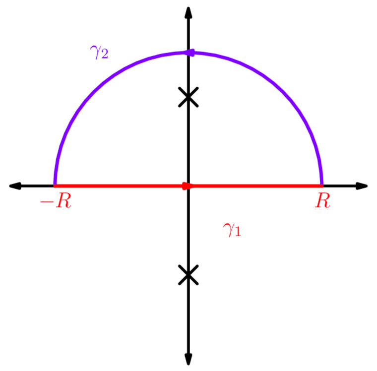

We only care about when $R$ is big... and when $R$ is big, the pole $z = i$ is always contained inside the loop! (And $z = -i$ is always outside, so we don't care about it.) Thus, the contour integral around the loop will only pick up the residue at $z = i$. Let's calculate that residue. We can write

$$\frac{1}{1+z^2} = \frac{1}{(z+i)(z-i)}.$$

Then we hope to get rid of the singularity by multiplying by a single factor of $(z - i)$. This results in $\dfrac{1}{z+i}$, and indeed we have removed the singularity, so the residue is given by evaluating this new expression at $z = i$, which is $\dfrac{1}{2i}$. By the Residue Theorem, we now have that

$$\int_{-R}^R \frac{1}{1+x^2} \, dx + \int_0^\pi \frac{iRe^{it}}{1+R^2e^{2it}} \, dt = \int_\gamma \frac{1}{1+z^2} \, dz = 2\pi i \operatorname*{Res}_{z=i} \frac{1}{1+z^2} = 2\pi i \cdot \frac{1}{2i} = \pi.$$

You might recognize that $\pi$ should be the answer to the integral! We're getting closer now. All we have to do now is send $R \to +\infty$. This gives us that

$$\int_{-\infty}^\infty \frac{1}{1+x^2} \, dx + \lim_{R \to +\infty} \int_0^\pi \frac{iRe^{it}}{1+R^2e^{2it}} \, dt = \pi.$$

If you only care about getting the answer (because you're like in an integration bee or something), you can stop now and say "clearly the limit $\displaystyle\lim_{R \to +\infty} \int_0^\pi \frac{iRe^{it}}{1+R^2e^{2it}} \, dt$ is $0$" by waving your hands. That's ok. But if you are curious about why this vanishes, I'll give you two options.

Option 1: Intuitive Reasoning

The integrand has one $R$ on top and an $R^2$ on the bottom, so as $R$ gets huge, the magnitude of the integrand should be asymptotically $\dfrac{1}{R}$. This goes to $0$ as $R \to +\infty$.

Option 2: Rigorous Reasoning

**Key Idea 3.5:** *Write a chain of inequalities that ends with an expression in terms of $R$ that clearly goes to $0$.*

To show that the integral goes to $0$, we're really trying to show that its absolute value goes to $0$. That is, we want to prove that

$$\left|\int_0^\pi \frac{iRe^{it}}{1+R^2e^{2it}} \, dt\right| \to 0$$

as $R \to +\infty$.

Here's the general idea: If, for example, we can show an inequality that looks like

$$\left|\int_0^\pi \frac{iRe^{it}}{1+R^2e^{2it}} \, dt\right| \overset{?}{\leq} \frac{100}{R},$$

then we would win because $100/R \to 0$ as $R \to +\infty$, and that must mean that the integral we're looking at also has to go to $0$!

In other words, our goal is to get an upper bound that goes to $0$ as $R \to +\infty$.

To do this, we need a few tools.

1. (Triangle Inequality) $|z + w| \leq |z| + |w|$ for all $z, w \in \C$.
2. (Integral Triangle Inequality) $\displaystyle\left|\int_a^b f(t) \, dt\right| \leq \int_a^b |f(t)| \, dt$, always!

First, we apply the integral triangle inequality to shove the absolute value bars inside.

$$\left|\int_0^\pi \frac{iRe^{it}}{1+R^2e^{2it}} \, dt\right| \leq \int_0^\pi \left|\frac{iRe^{it}}{1+R^2e^{2it}}\right| dt$$

Next, we manipulate this expression using absolute value properties.

$$\begin{aligned}
&= \int_0^\pi \frac{|iRe^{it}|}{|1+R^2e^{2it}|} \, dt \\
&= \int_0^\pi \frac{R}{|1+R^2e^{2it}|} \, dt
\end{aligned}$$

The numerator simplified nicely, but the bottom needs to be tamed still. To continue, we use the triangle inequality, which tells us that $|R^2e^{2it}| \leq |-1| + |1+R^2e^{2it}|$, which rearranges to the *lower* bound $|1+R^2e^{2it}| \geq R^2 - 1$. You might be thinking that this is the wrong way, but actually, since we're in the denominator, we need a lower bound in order to write an upper bound on the whole fraction. That is, since $|1+R^2e^{2it}| \geq R^2 - 1$, we have that $\dfrac{R}{|1+R^2e^{2it}|} \leq \dfrac{R}{R^2-1}$. So we can continue "going up"!

$$\int_0^\pi \frac{R}{|1+R^2e^{2it}|} \, dt \leq \int_0^\pi \frac{R}{R^2-1} \, dt$$

Wait a second, $t$ doesn't appear anymore! So we can evaluate this upper bound.

$$= \frac{\pi R}{R^2-1}$$

This is an upper bound that goes to $0$ as $R \to +\infty$! That's exactly what we needed, therefore we can conclude that

$$\lim_{R \to +\infty} \int_0^\pi \frac{iRe^{it}}{1+R^2e^{2it}} \, dt = 0.$$

Whatever you do, we finally have ended up with

$$\boxed{\int_{-\infty}^\infty \frac{1}{1+x^2} \, dx = \pi},$$

and so we are done!

The next example shows that sometimes, the given integrand is not necessarily the thing we would like to integrate.

### Example 2

Let us evaluate the integral

$$\int_{-\infty}^\infty \frac{\cos x}{1+x^2} \, dx.$$

We will use the same exact approach, but the cosine here is annoying to deal with. One way to deal with it is to use the fact that $\cos z = \dfrac{e^{iz}+e^{-iz}}{2}$, because $e^{iz}$ is easier to deal with. However, a much easier approach is to realize that $\cos x$ is just the real part of $e^{ix}$!

**Key Idea 4:** *If there is a sine or cosine, consider replacing it with $e^{ix}$. Under suitable conditions, the real/imaginary part of the new integral will be exactly the original integral.*

So we can instead think about the integral

$$\int_{-\infty}^\infty \frac{e^{ix}}{1+x^2} \, dx.$$

Once we evaluate this, we take the real part of the answer, and this will be the answer to the integral $\displaystyle\int_{-\infty}^\infty \frac{\cos x}{1+x^2} \, dx$.

Let's run the process again! We use the same contour as before. I'm going to go a bit faster now and explain the steps a little less than before.

The integral over the bottom is just $\displaystyle\int_{-R}^R \frac{e^{ix}}{1+x^2} \, dx$, which will be what we want when we send $R \to +\infty$.

The integral over the semicircular arc will be

$$\int_{\gamma_2} \frac{e^{iz}}{1+z^2} \, dz = \int_0^\pi \frac{e^{iRe^{it}} \cdot iRe^{it}}{1+R^2e^{2it}} \, dt.$$

The residue of $\dfrac{e^{iz}}{1+z^2}$ at $z = i$ is simply $\dfrac{e^{iz}}{z+i}$ evaluated at $z = i$, which is $\dfrac{1}{2ie}$. Thus, by the Residue Theorem, we have

$$\int_{-R}^R \frac{e^{ix}}{1+x^2} \, dx + \int_0^\pi \frac{e^{iRe^{it}} \cdot iRe^{it}}{1+R^2e^{2it}} \, dt = 2\pi i \cdot \frac{1}{2ie} = \frac{\pi}{e}.$$

Sending $R \to +\infty$, we have

$$\int_{-\infty}^\infty \frac{e^{ix}}{1+x^2} \, dx + \int_0^\pi \frac{e^{iRe^{it}} \cdot iRe^{it}}{1+R^2e^{2it}} \, dt = \frac{\pi}{e}$$

The integral in the middle vanishes

$$\begin{aligned}
\left|\int_0^\pi \frac{e^{iRe^{it}} \cdot iRe^{it}}{1+R^2e^{2it}} \, dt\right| &\leq \int_0^\pi \frac{\left|e^{iRe^{it}} \cdot iRe^{it}\right|}{|1+R^2e^{2it}|} \, dt \\
&\leq R\int_0^\pi \frac{\left|e^{iRe^{it}}\right|}{R^2-1} \, dt \\
&= R\int_0^\pi \frac{\left|e^{i(R\cos t + iR\sin t)}\right|}{R^2-1} \, dt \\
&= \frac{R}{R^2-1}\int_0^\pi e^{-R\sin t} \, dt
\end{aligned}$$

Now use the fact that $\sin t \geq 0$ over the domain of integration.

$$\leq \frac{R}{R^2-1}\int_0^\pi 1 \, dt = \frac{\pi R}{R^2-1} \to 0$$

and so therefore

$$\int_{-\infty}^\infty \frac{e^{ix}}{1+x^2} \, dx = \frac{\pi}{e}.$$

The original integral, $\displaystyle\int_{-\infty}^\infty \frac{\cos x}{1+x^2} \, dx$, is thus the real part of $\pi/e$... which is just $\pi/e$. We conclude that

$$\boxed{\int_{-\infty}^\infty \frac{\cos x}{1+x^2} \, dx = \frac{\pi}{e}}.$$

This next example shows that the "arcs" we draw aren't always negligible. They might actually be useful.

### Example 3

Let us evaluate the *improper Riemann* integral

$$\int_{-\infty}^\infty \frac{\sin x}{x} \, dx.$$

Why do I specify Riemann?

There are two types of integrals: Riemann and Lebesgue. Although these two types of integrals give the same answer in almost all cases, most mathematicians use Lebesgue integrals because they have nicer properties and are so much easier to work with.

$\sin x / x$ is an example of a function where the two types of integrals differ. It is Riemann-integrable (in an improper sense), whereas in the Lebesgue sense it is not integrable!

Firstly, instead of looking at $\sin x$, we will look at $e^{ix}$. So we will take the *imaginary* part of the answer to the integral $\displaystyle\int_{-\infty}^\infty \frac{e^{ix}}{x} \, dx$.

Now we choose the contour.

**Key Idea 5:** *The contour you choose needs to dodge singularities (while also sticking to the real line as much as it can).*

We're tempted to pick the same semi-circular contour, but there is a problem: The semicircle crosses $z = 0$, where $\dfrac{\sin z}{z}$ is not defined. We must "dodge" this singularity with... another semi-circular arc.

So, in addition to having a bit $R > 0$ for the big circular arc, we will also need a small $\varepsilon > 0$ that controls the radius of a *small* semi-circular arc that serves to dodge this singularity. In all, the contour we choose will have four parts.

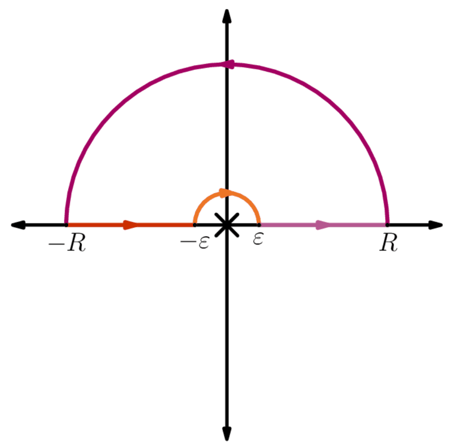

The integrals over the two straight-segment parts are simply $\displaystyle\int_{-R}^{-\varepsilon} \frac{e^{ix}}{x} \, dx$ and $\displaystyle\int_\varepsilon^R \frac{e^{ix}}{x} \, dx$. When we add these together and send $R \to +\infty$ and $\varepsilon \to 0^+$, that will give us $\displaystyle\int_{-\infty}^\infty \frac{e^{ix}}{x} \, dx$, the integral we need to study. (Technically, this is a principal value since we cut out a symmetric gap around $0$, but that's harmless here: the real part $\cos x / x$ is odd so it contributes nothing, and the imaginary part $\sin x / x$ is perfectly nice at $0$.)

The integral over the larger semicircular arc is

$$\int_0^\pi \frac{e^{iRe^{it}} \cdot Rie^{it}}{Re^{it}} \, dt = \int_0^\pi ie^{iRe^{it}} \, dt.$$

The integral over the smaller semicircular arc is

$$-\int_0^\pi \frac{e^{i\varepsilon e^{it}} \cdot \varepsilon ie^{it}}{\varepsilon e^{it}} \, dt = -\int_0^\pi ie^{i\varepsilon e^{it}} \, dt.$$

(The integral is negated because the contour is going clockwise, not counter-clockwise!)

By Cauchy's Theorem (there are no singularities inside the loop!), the integral over the entire contour is $0$. That is,

$$\int_{-R}^{-\varepsilon} \frac{e^{ix}}{x} \, dx + \int_\varepsilon^R \frac{e^{ix}}{x} \, dx + \int_0^\pi ie^{iRe^{it}} \, dt - \int_0^\pi ie^{i\varepsilon e^{it}} \, dt = 0$$

When we send $R \to +\infty$, the third term vanishes.

Why the third term vanishes

$$\begin{aligned}
\left|\int_0^\pi ie^{iRe^{it}} \, dt\right| &\leq \int_0^\pi \left|ie^{iRe^{it}}\right| dt \\
&= \int_0^\pi \left|e^{iR(\cos t + i\sin t)}\right| dt \\
&= \int_0^\pi e^{-R\sin t} \, dt
\end{aligned}$$

If you know what "dominated convergence" is, you can now win easily, because the integrand goes to $0$ as $R \to +\infty$ and the integrand is dominated by the constant function $1$, which has a finite integral, so $\displaystyle\lim_{R \to +\infty} \int_0^\pi e^{-R\sin t} \, dt = 0$.

Otherwise, here is an alternative: Use the fact that $\sin(t)$ is symmetric about $\pi/2$ to set this equal to

$$= 2\int_0^{\pi/2} e^{-R\sin t} \, dt.$$

Now, use the fact that the line segment between $(0, 0)$ and $(\pi/2, 1)$ lies under the graph of $\sin t$. This tells us that $\sin t \geq \dfrac{2}{\pi}t$, which implies that $-R\sin t \leq \dfrac{-2Rt}{\pi}$. Hence we may go up with:

$$\begin{aligned}
&\leq 2\int_0^{\pi/2} e^{\frac{-2Rt}{\pi}} \, dt \\
&= \frac{\pi(1-e^{-R})}{R} \to 0
\end{aligned}$$

so

$$\int_{-\infty}^{-\varepsilon} \frac{e^{ix}}{x} \, dx + \int_\varepsilon^\infty \frac{e^{ix}}{x} \, dx - \int_0^\pi ie^{i\varepsilon e^{it}} \, dt = 0$$

Now we need to send $\varepsilon \to 0^+$...

$$\int_{-\infty}^\infty \frac{e^{ix}}{x} \, dx = \lim_{\varepsilon \to 0^+} \int_0^\pi ie^{i\varepsilon e^{it}} \, dt$$

...but that last term isn't going to vanish! It will have an actual limit.

I don't want to make this post any longer so I'm going to be extremely not rigorous. We write

$$\lim_{\varepsilon \to 0^+} \int_0^\pi ie^{i\varepsilon e^{it}} \, dt = \int_0^\pi \lim_{\varepsilon \to 0^+} ie^{i\varepsilon e^{it}} \, dt = \int_0^\pi i \, dt = i\pi.$$

More Rigor

The issue is swapping the limit and integral. You cannot do that in general. Here is more or less how you go about doing it right: You have to use something called the **(Lebesgue) Dominated Convergence Theorem**. This needs two ingredients.

**Ingredient 1: Pointwise Convergence**

What this means is that the integrand has a limit basically everywhere. Here, we see that the limit $\displaystyle\lim_{\varepsilon \to 0^+} ie^{i\varepsilon e^{it}}$ always exists (and is equal to $i$) no matter what $t$ is.

**Ingredient 2: Domination**

What this means is that you can find an *integrable upper bound* for the absolute value of the integrand that does NOT depend on the limit variable (which, here, would be $\varepsilon$). Integrable means "has finite integral".

Here, I can write

$$\left|ie^{i\varepsilon e^{it}}\right| = \left|e^{i\varepsilon(\cos t + i\sin t)}\right| = e^{-\varepsilon\sin t} \leq 1.$$

$1$ is a valid dominator because it does not depend on $\varepsilon$ and it is integrable (i.e. $\displaystyle\int_0^\pi |1| \, dt < \infty$).

With these two ingredients, we are allowed to switch the limit and the integral.

Therefore,

$$\int_{-\infty}^\infty \frac{e^{ix}}{x} \, dx = i\pi.$$

The original integral, $\displaystyle\int_{-\infty}^\infty \frac{\sin x}{x} \, dx$, is just the imaginary part of $i\pi$... which is $\pi$. Thus

$$\boxed{\int_{-\infty}^\infty \frac{\sin x}{x} \, dx = \pi}.$$

Our last example uses contour integration in a "backwards" way.

### Example 4

Let us evaluate the integral

$$\int_0^{2\pi} \frac{\sin^2 t}{5+4\cos t} \, dt.$$

Two problems: (1) I don't like trig functions. (2) I like complex numbers. Both of these problems are easily solved using the following formulas:

$$\cos t = \frac{e^{it}+e^{-it}}{2}$$

$$\sin t = \frac{e^{it}-e^{-it}}{2i}$$

Let's replace the cosines and sines with these guys and see what happens!

$$\begin{aligned}
\int_0^{2\pi} \frac{\sin^2 t}{5+4\cos t} \, dt &= \int_0^{2\pi} \frac{\left(\frac{e^{it}-e^{-it}}{2i}\right)^2}{5+4\cdot\frac{e^{it}+e^{-it}}{2}} \, dt \\
&= \frac{-1}{4}\int_0^{2\pi} \frac{e^{2it}-2+e^{-2it}}{5+2e^{it}+2e^{-it}} \, dt
\end{aligned}$$

Hm, since $e^{it}$ appears so much, this *kinda* looks like the integral we would get if we were integrating some function over the contour $\partial D$... right? Could we do something with this?

**Key Idea 6:** *Sometimes, you can manipulate the integrand so that it becomes the formula for a contour integral.*

Remember that if we parametrize $\partial D$ by $e^{it}$, then the integral $\displaystyle\int_{\partial D} f(z) \, dz$ is given by $\displaystyle\int_0^{2\pi} f(e^{it}) \cdot ie^{it} \, dt$. So... what this means is that if we manipulate our integrand to look like $f(e^{it}) \cdot ie^{it}$, then we can apply this formula *backwards* to write the integral as a contour integral!

The extra factor we need is $ie^{it}$... so let's just force it in!

$$\frac{-1}{4}\int_0^{2\pi} \frac{e^{2it}-2+e^{-2it}}{5+2e^{it}+2e^{-it}} \, dt = \frac{-1}{4}\int_0^{2\pi} \frac{e^{2it}-2+e^{-2it}}{(5+2e^{it}+2e^{-it})ie^{it}} \cdot ie^{it} \, dt$$

Voila! By applying the formula for contour integrals in reverse, this is just the contour integral

$$\begin{aligned}
\frac{-1}{4}\int_{\partial D} \frac{z^2-2+z^{-2}}{(5+2z+2z^{-1})iz} \, dz &= \frac{-1}{4i}\int_{\partial D} \frac{z^4-2z^2+1}{z^2(2z^2+5z+2)} \, dz \\
&= \frac{-1}{4i}\int_{\partial D} \frac{(z^2-1)^2}{z^2(2z+1)(z+2)} \, dz.
\end{aligned}$$

We now apply the Residue Theorem! The integrand explodes at three points: $z = 0$, $z = -1/2$ and $z = -2$. Only $z = 0$ and $z = -1/2$ are inside the circle. Calculating the residue at $z = -1/2$ is pretty easy, but $z = 0$ is more annoying because it is a second-order pole, so using the easy method I outlined doesn't really work. There are two ways to proceed.

Method 1: The Ugly Formula

If you read about the ugly formula back in Lesson 6, you know the steps to actually find the residue at $z = 0$.

First, we need to find the first power of $(z - 0) = z$ that will get rid of the singularity. Obviously, it's $z^2$.

Now, we multiply by that to get rid of the singularity. This leaves us with $\dfrac{z^4-2z^2+1}{2z^2+5z+2}$.

Now, we differentiate this $2 - 1 = 1$ times. By the quotient rule, this gives

$$\frac{(4z^3-4z)(2z^2+5z+2) - (z^4-2z^2+1)(4z+5)}{(2z^2+5z+2)^2}.$$

Finally, we plug in $z = 0$ into this to get $\dfrac{-5}{4}$. This is the residue!

As for the residue at $z = -1/2$, we multiply by $z + 1/2$ to leave us with $\dfrac{(z^2-1)^2}{z^2(2)(z+2)}$ (note the extra factor of $2$), and now when we plug in $z = -1/2$, that's just

$$\frac{((-1/2)^2-1)^2}{(-1/2)^2(2)(-1/2+2)} = \frac{9/16}{(1/4)(2)(3/2)} = \frac{3}{4}.$$

Altogether, we conclude that

$$\frac{1}{-4i}\int_{\partial D} \frac{(z^2-1)^2}{z^2(2z+1)(z+2)} \, dz = \frac{1}{-4i} \cdot 2\pi i\left[\frac{-5}{4} + \frac{3}{4}\right] = \boxed{\frac{\pi}{4}}.$$

Method 2: Partial Fractions

This is a very simple workaround, but it might be a tad more tedious. If we use "Heaviside cover-up partial fraction decomposition", we can find that

$$\frac{(z^2-1)^2}{z^2(2z+1)(z+2)} = \frac{1/2}{z^2} + \frac{-3/4}{z+2} + \frac{3/4}{z+1/2} + \frac{-5/4}{z} + \frac{1}{2}.$$

So the integral we need to evaluate is just

$$\frac{-1}{4i}\int_{\partial D} \frac{1/2}{z^2} + \frac{-3/4}{z+2} + \frac{3/4}{z+1/2} + \frac{-5/4}{z} + \frac{1}{2} \, dz.$$

So we can just go term by term!

- We have $\displaystyle\int_{\partial D} \frac{1/2}{z^2} \, dz = 0$, if you plug in a parametrization and do it manually.
- $\displaystyle\int_{\partial D} \frac{-3/4}{z+2} \, dz = 0$ by Cauchy's Theorem.
- $\displaystyle\int_{\partial D} \frac{3/4}{z+1/2} \, dz = \frac{3\pi i}{2}$ by the Residue Theorem.
- $\displaystyle\int_{\partial D} \frac{-5/4}{z} \, dz = \frac{-5\pi i}{2}$ by the Residue Theorem.
- $\displaystyle\int_{\partial D} \frac{1}{2} \, dz = 0$ by Cauchy's Theorem.

Therefore,

$$\frac{-1}{4i}\int_{\partial D} \frac{(z^2-1)^2}{z^2(2z+1)(z+2)} \, dz = \frac{-1}{4i}\left(\frac{3\pi i}{2} - \frac{5\pi i}{2}\right) = \boxed{\frac{\pi}{4}}.$$

Either way, we got the answer of $\boxed{\dfrac{\pi}{4}}$. Whew!

## Your Turn

The way to master this method is by practicing! I have provided a number of practice problems that are in **no particular order**. If you need them, the hints will basically remove any guesswork you need to do by telling you what contour to take and/or what methodologies to use. And, just in case you want more guidance, I've written out the solution to two of these problems.

Happy integrating!

::: exercise
Evaluate $\displaystyle\int_0^\infty \frac{1}{1+x^4} \, dx$.

Hint

You can use a semicircle contour, and the symmetry of the integrand. The two residues you need to deal with are at $z = (\pm 1 + i)/\sqrt{2}$.

Alternatively, use this:

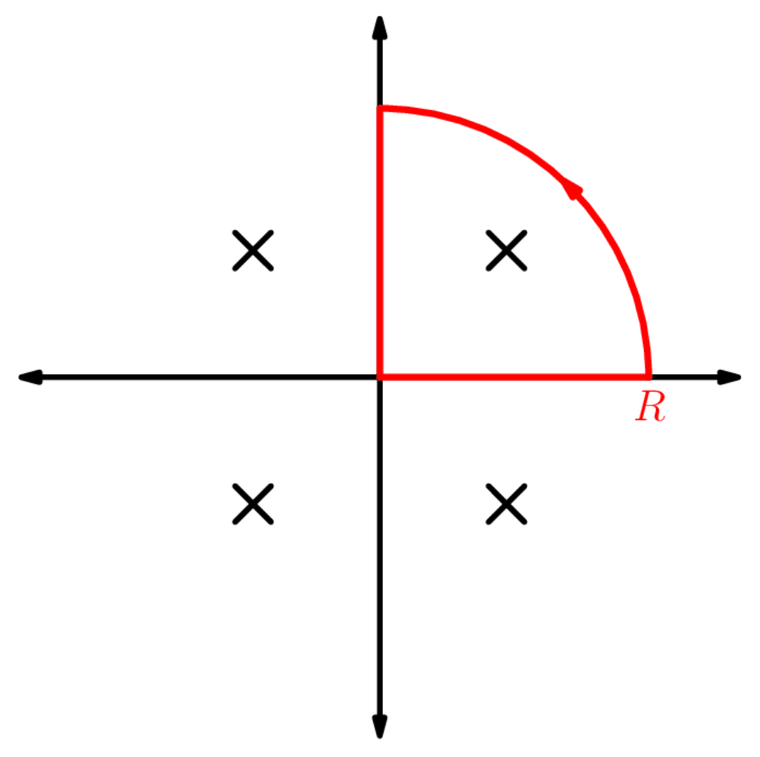

That way you only need to deal with one residue.

Answer

$\dfrac{\pi}{2\sqrt{2}}$

Solution

Let's use the quarter arc contour given in the hint. The integral over this contour is

$$\int_0^R \frac{1}{1+x^4} \, dx - i\int_0^R \frac{1}{1+x^4} \, dx + \int_0^{\pi/2} \frac{Rie^{it}}{1+R^4e^{4it}} \, dt.$$

(Note that we used the fact that $i^4 = 1$ for the second term.) Let's use the Residue Theorem to evaluate this. The only residue inside the quarter arc is the one at $e^{i\pi/4} = (1+i)/\sqrt{2} =: z_0$. The residue at this singularity is

$$\frac{1}{(z_0 - e^{3i\pi/4})(z_0 - e^{5i\pi/4})(z_0 - e^{7i\pi/4})} = \frac{1}{(\sqrt{2})(\sqrt{2}(1+i))(\sqrt{2}i)} = \frac{1}{2^{3/2}(-1+i)} = \frac{-1-i}{2^{5/2}}.$$

It follows by the Residue Theorem that

$$\int_0^R \frac{1}{1+x^4} \, dx - i\int_0^R \frac{1}{1+x^4} \, dx + \int_0^{\pi/2} \frac{Rie^{it}}{1+R^4e^{4it}} \, dt = 2\pi \cdot \frac{1-i}{2^{5/2}}.$$

Sending $R \to +\infty$, we get

$$\int_0^\infty \frac{1}{1+x^4} \, dx - i\int_0^\infty \frac{1}{1+x^4} \, dx = 2\pi \cdot \frac{1-i}{2^{5/2}}$$

because the third term vanishes (and this is not hard to show and/or intuit). Dividing by $1 - i$, we end up with

$$\boxed{\int_0^\infty \frac{1}{1+x^4} \, dx = \frac{\pi}{2^{3/2}}}.$$

:::

::: exercise
Evaluate $\displaystyle\int_0^\infty \frac{\log x}{1+x^4} \, dx$.

Small Hint

We can't use a semicircle here either, because it would cross the negative real line, and $\log$ isn't defined there. Well, we still want to draw a loop that goes from $0$ to $R$ in a straight line and then gets back to $0$. What's a natural way to go from $R$ to $0$?

Also, to evaluate principal logs, keep in mind that $\log z = \log(r) + i\theta$ where $r = |z|$ and $\theta \in (-\pi, \pi)$ is such that $z = re^{i\theta}$.

Big Hint

Use this:

Answer

$\dfrac{-\pi^2}{8\sqrt{2}}$

:::

::: exercise
(\*) Evaluate $\displaystyle\int_0^\infty \frac{1}{1+x^3} \, dx$.

Subtle Hint

The semicircle contour doesn't work here either. Think about what went wrong. Then, think of a better way to make a path from $R$ back to $0$.

Big Hint

Use this:

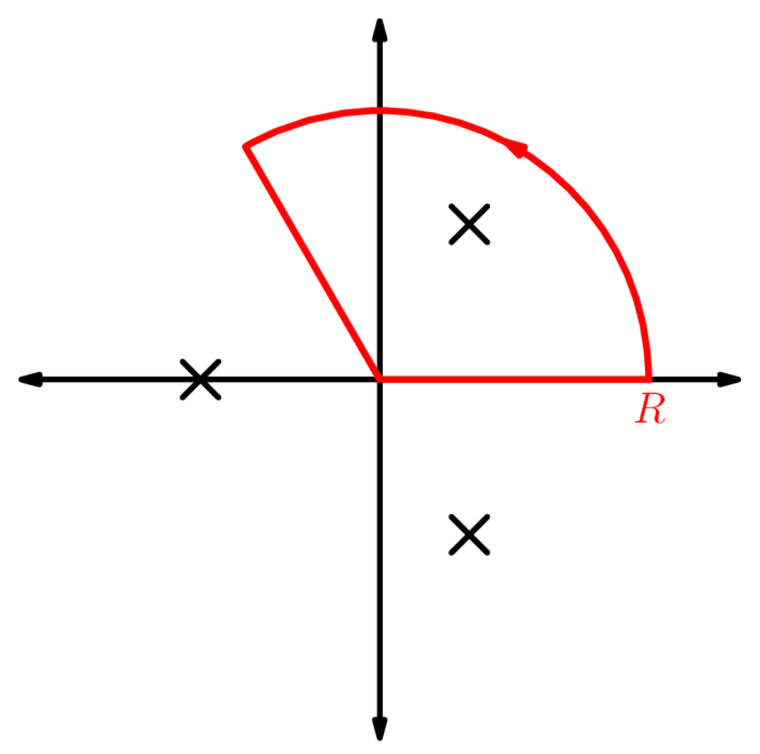

Answer

$\dfrac{2\pi}{3\sqrt{3}}$

:::

::: exercise
(\*) Can you find a formula for $\displaystyle\int_0^\infty \frac{1}{1+x^n} \, dx$ for positive integers $n$?
:::

::: exercise
Evaluate $\displaystyle\int_0^\pi \frac{d\theta}{1+\cos^2\theta}$.

Hint 1

Replace $\cos\theta$ with $(e^{i\theta}+e^{-i\theta})/2$.

Hint 2

Turn it into a contour integral on $\partial D$. Except... the parametrization is going to be different if you want a full loop, since the upper bound is $\pi$, not $2\pi$. Hmm... look at what terms you have in your integrand, any nice ideas pop up?

Hint 3

Write the integrand in the form $\displaystyle\int_0^\pi f(e^{2i\theta}) \cdot 2ie^{2i\theta} \, d\theta$.

Answer

$\dfrac{\pi}{\sqrt{2}}$

Solution

Use the "backwards" trick, like in Example 4.

$$\begin{aligned}
\int_0^\pi \frac{1}{1+\cos^2 t} \, dt &= \int_0^\pi \frac{1}{1+\left(\frac{e^{it}+e^{-it}}{2}\right)^2} \, dt \\
&= 4\int_0^\pi \frac{1}{e^{2it}+6+e^{-2it}} \, dt \\
&= \frac{2}{i}\int_0^\pi \frac{1}{e^{4it}+6e^{2it}+1} \cdot 2ie^{2it} \, dt \\
&= \frac{2}{i}\int_{\partial D} \frac{1}{z^2+6z+1} \, dz \\
&= \frac{2}{i}\int_{\partial D} \frac{1}{(z-(-3+2\sqrt{2}))(z-(-3-2\sqrt{2}))} \, dz
\end{aligned}$$

The only singularity that lies inside the unit circle is $z = -3 + 2\sqrt{2}$. The residue at this singularity is $\dfrac{1}{z-(-3-2\sqrt{2})}$ evaluated at $z = -3+2\sqrt{2}$, or $\dfrac{1}{4\sqrt{2}}$. So by the Residue Theorem,

$$\frac{2}{i}\int_{\partial D} \frac{1}{(z-(-3+2\sqrt{2}))(z-(-3-2\sqrt{2}))} \, dz = \frac{2}{i} \cdot 2\pi i \cdot \frac{1}{4\sqrt{2}} = \boxed{\frac{\pi}{\sqrt{2}}}.$$

:::

::: exercise
Evaluate $\displaystyle\int_0^{2\pi} \frac{d\theta}{13+12\cos\theta}$.

Answer

$\dfrac{2\pi}{5}$

:::

::: exercise
Evaluate $\displaystyle\int_{-\infty}^\infty \frac{1-\cos x}{x^2} \, dx$.

Hint 1

Instead integrate $\displaystyle\int_{-\infty}^\infty \frac{1-e^{ix}}{x^2} \, dx$ and take its real part.

Hint 2

Use a semi-circular contour that dodges $0$.

Answer

$\pi$

:::

::: exercise
(\*) Evaluate $\displaystyle\int_0^\infty \cos(x^2) \, dx$.

Hint 1

The best integrand to look at is $e^{-z^2}$. You want to use the Gaussian integral.

Hint 2

This contour was hard to come up with. Use this:

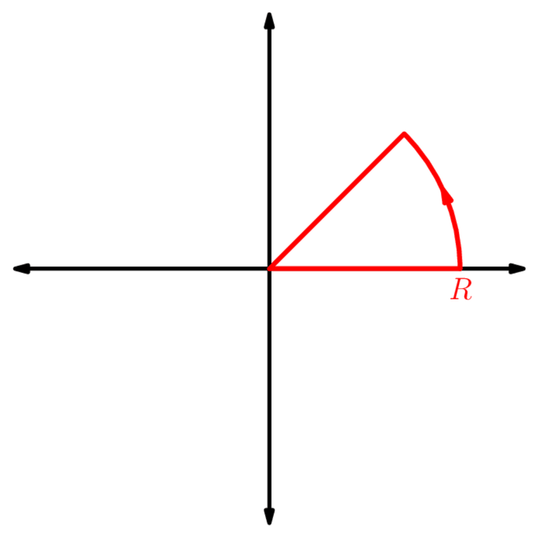

Answer

$\sqrt{\pi/8}$

:::

