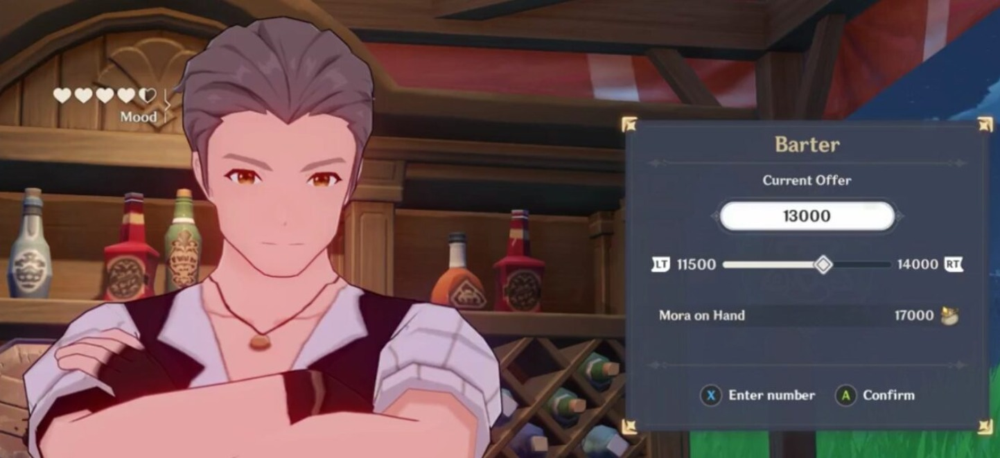
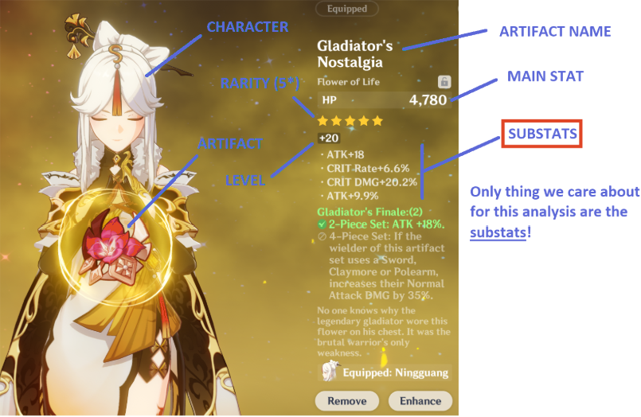
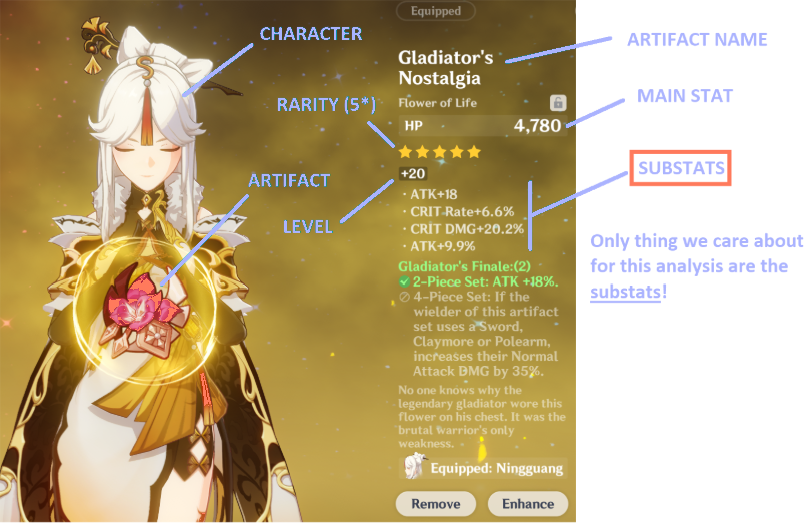
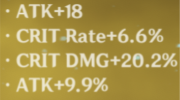
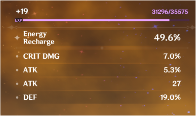
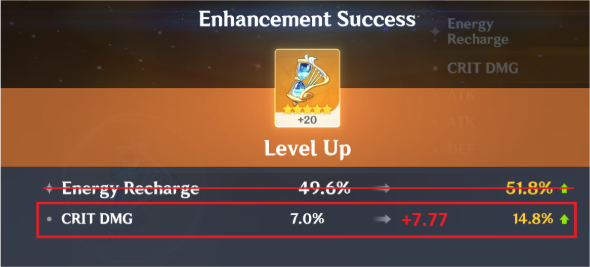
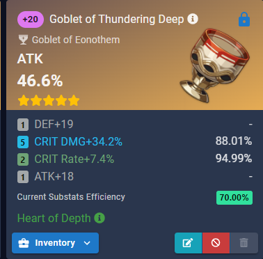

Genshin is probably not as popular nowadays but there was a time where it had a chokehold over most of my friends shortly after the COVID pandemic. Regardless, I will write this for a general audience although if you play the game, you will probably enjoy this post more.

*Genshin Impact* is a relatively new game by MiHoYo.

* It is an *open world* game, meaning that it consists of a huge world map to explore. No area is locked for exploration, meaning you can basically go anywhere you want from the getgo (except Inazuma)
* It is an *RPG*. You play as various characters and you can level them up in various ways to make them stronger, so that you can tackle stronger enemies and bosses.
* Lastly, it is a *gacha game*, which is one of the more notorious aspects of Genshin. Essentially, this means that there are heavy luck-based mechanics for getting new characters (and weapons). Moreover, you can spend real-life money to increase the odds of getting a certain character you want. This is how they make money, since Genshin itself is a free (!) game.
* Genshin is insanely popular for the open world, its anime art-style, and (bluntly) cute girls according to my friends.

I will be showcasing how math can be surprisingly helpful in deep end Genshin Impact theory in three (in my opinion) increasingly rigorous facets of the game. This is my own work, but I won't be surprised if this math has been done before.

DISCLAIMERS

1. Genshin Impact is a highly addictive game. Seriously, it will very likely take up a ton of your free time. Do not start playing unless you have a ton of time to kill.
2. The gacha system in Genshin Impact is gambling, which is addictive. Do NOT spend money on this game unless you are a millionaire. If you do spend money, please be careful and be mindful of your spendings. Gambling addiction has destroyed lives, even in gachas, and it can happen to you.
3. (That being said, Genshin Impact is certainly a beautiful game, and despite its faults, most of my friends express immense happiness to have gotten to experience its world. If you've been looking for a new game to play, I am sure they would all recommend giving Genshin a try. Just make sure you have the time to kill, and be careful when dealing with the Gacha aspects.)

## Bargaining Prices

### The Premise

Genshin Impact includes minigames in which you negotiate on a price with someone. You get some number of attempts to offer a price until they get very upset. The goal is to purchase what you want by offering the lowest price you can.

Let's formulate this into mathspeak. Let $n$ be a positive integer. The price $p$ of a prize is selected uniformly at random from the interval $[0, 1]$, but is not revealed to you. You are to offer a price $x$ between $0$ and $1$.

* If $x \ge p$, then the prize is sold and you pay $x$.
* If $x < p$, you're told that the offer is too low, and you must offer another price.

You may get a total of $n$ attempts to offer a price. You *must* succeed in buying the prize within the $n$ attempts.

What strategy should I follow to minimize the expected value of the price I end up paying?

**Example game 1**

Let $n = 5$.

1. I offer $0.3$. It's not enough. (I now know that $0.3 < p \le 1$)
2. I offer $0.7$. This happens to be enough, and so I end up paying $0.7$ with three attempts to spare.

**Example game 2**

Let $n = 4$.

1. I offer $0.1$. It's not enough. (I now know that $0.1 < p \le 1$)
2. I offer $0.2$. It's still not enough. (I now know that $0.2 < p \le 1$)
3. I offer $0.8$. It's still not enough.
4. I'm out of extra attempts, so I must offer $1$ now to guarantee the purchase. This is indeed enough and I pay $1$.

### Solution

We claim that the minimum you need to pay in expectation is

Answer

$\frac12+\frac1{2n}$.

The first observation is that we can fully decide which prices to offer beforehand. We shouldn't need to change our strategy in the middle of the game based on what happens. Also, each offer should be higher than the previous offer. So, let's suppose that our first offer is $x_1$, then the next offer is $x_2$ *more* than that, and then the next offer increases by another $x_3$, and so on. So our list of offers is:

* $x_1$
* $x_1 + x_2$
* $x_1 + x_2 + x_3$
* $\dots$
* $x_1 + x_2 + x_3 + \dots + x_n$

If we ever actually have to use up all our offering attempts, then the last offer must be $1$. That means that our variables must be subject to the condition $x_1 + x_2 + \dots + x_n = 1$.

What's the expected value of the amount we end up paying?

* There's an $x_1$ chance that $0 \le p \le x_1$, and if this happens then we pay $x_1$, so one of the terms for the expected value is $x_1(x_1)$.
* There's an $x_2$ chance that $x_1 < p \le x_1 + x_2$, and if this happens then we pay $x_1 + x_2$, so the next term is $x_2(x_1 + x_2)$.
* There's an $x_3$ chance that $x_1 + x_2 < p \le x_1 + x_2 + x_3$, and if this happens then we pay $x_1 + x_2 + x_3$, so the next term is $x_3(x_1 + x_2 + x_3)$.
* $\dots$
* There's an $x_n$ chance that $x_1 + \dots + x_{n-1} < p \le x_1 + \dots + x_n$, and if this happens then we pay $x_1 + x_2 + \dots + x_n$, so the last term is $x_n(x_1 + x_2 + \dots + x_n)$.

Altogether, the expected value is:

$$x_1(x_1) + x_2(x_1 + x_2) + x_3(x_1 + x_2 + x_3) + \dots + x_n(x_1 + \dots + x_n)$$

Using the distributive property, this can be expanded to become

$$(x_1^2 + x_2^2 + \dots + x_n^2) + (x_1x_2 + x_1x_3 + x_2x_3 + \dots + x_{n-1}x_n).$$

That is, we have the sum of the squares, and then we add up every possible way to multiply an $x_i$ and an $x_j$ (with $i \ne j$).

This reminds me a lot of how you expand $(x_1 + x_2 + \dots + x_n)^2$. This is great, because $x_1 + x_2 + \dots + x_n = 1$, so this could really help simplify things.

Hmm, it's not *quite* the same expression though, since

$$1 = (x_1 + x_2 + \dots + x_n)^2 = (x_1^2 + x_2^2 + \dots + x_n^2) + 2(x_1x_2 + x_1x_3 + x_2x_3 + \dots + x_{n-1}x_n).$$

But that right side does kinda look like it! Let's do some algebra to "massage" this expression into what the expected value looks like. First, we add $(x_1^2 + x_2^2 + \dots + x_n^2)$ to both sides.

$$(x_1^2 + x_2^2 + \dots + x_n^2) + 1 = 2(x_1^2 + x_2^2 + \dots + x_n^2) + 2(x_1x_2 + x_1x_3 + x_2x_3 + \dots + x_{n-1}x_n)$$

Then, we divide by $2$.

$$\frac{(x_1^2 + x_2^2 + \dots + x_n^2) + 1}{2} = (x_1^2 + x_2^2 + \dots + x_n^2) + (x_1x_2 + x_1x_3 + x_2x_3 + \dots + x_{n-1}x_n)$$

And hey, that right side is now the expected value! So

$$\text{Expected Value} = \frac{(x_1^2 + x_2^2 + \dots + x_n^2) + 1}{2}.$$

Huh, what were we trying to do again? Right, we're trying to find the minimum possible expected value for some nice choices for $x_1, x_2, \cdots, x_n$, and so we're trying to find the minimum possible value of $\dfrac{(x_1^2 + x_2^2 + \dots + x_n^2) + 1}{2}$.

Inequality fans know what's coming! We use the powerful QM-AM inequality!

$$\sqrt{\frac{x_1^2 + x_2^2 + \dots + x_n^2}{n}} \ge \frac{x_1 + x_2 + \dots + x_n}{n}$$

If we rearrange this, we get that

$$x_1^2 + x_2^2 + \dots + x_n^2 \ge \frac{(x_1 + x_2 + \dots + x_n)^2}{n} = \frac1n.$$

The helpful $x_1 + x_2 + \dots + x_n = 1$ came to the rescue again! Now,

$$\text{Expected Value} = \frac{(x_1^2 + x_2^2 + \dots + x_n^2) + 1}{2} \ge \frac{1/n + 1}{2} = \boxed{\frac12 + \frac1{2n}},$$

which is what I claimed.

But remember, whenever you're proving that something is the minimum, you always have to prove that it's *obtainable*. Right now, I've only shown that $\frac12 + \frac1{2n}$ is a lower bound. If I wanted a lower bound, I could just pick like $-12345$ and be done with it, that's no fun.

The only part where an inequality came in was when we used QM-AM. That means that the only way to obtain the proposed minimum value is to achieve the *equality case* in the inequality

$$\sqrt{\frac{x_1^2 + x_2^2 + \dots + x_n^2}{n}} \ge \frac{x_1 + x_2 + \dots + x_n}{n}.$$

Fortunately some smart people already figured out that this happens exactly when all the variables are equal, i.e. $x_1 = x_2 = \dots = x_n$. Combined with the condition that $x_1 + x_2 + \dots + x_n = 1$, we see that the minimum expected value is obtained when we choose $x_1 = 1/n$, $x_2 = 1/n$, $\cdots$, and $x_n = 1/n$.

This finishes the proof, and that "equality case" also tells us that the best strategy is to offer $1/n$, then $2/n$, then $3/n$, etc. all the way up to $n/n$.

---

It's always useful to do a quick sanity check to make sure that the answer you get makes sense.

When I plug in $n = 1$, the minimum expected value is $1$. This makes sense because your first offer has to be $1$.

Also, it makes sense that the minimum expected value keeps decreasing the more offers you're allowed to make.

What's interesting is that, no matter how many offers we're allowed to make, we can never do better than $1/2$ in expected value. This probably makes sense, because the expected value of $p$ in the first place is $1/2$, and we shouldn't anticipate being able to do better than the original expected value.

Hm, this makes me wonder what happens if $p$ was *not* chosen with a uniform distribution... Will it always be the case that we can't do better than $\mathbb{E}p$? Exciting!

## Sucrose vs. Dori

In Genshin, there is a very simplistic "crafting" system. Different characters give different bonuses when crafting. Two such characters are Sucrose and Dori.

Here is the setup, in alternative terms: Suppose you start with $n$ "tokens". Sucrose and Dori are two different people that can exchange your tokens for money.

* When you give Sucrose $3$ tokens, she will give you a dollar. Then, there is a $10\%$ chance that she gives you a second dollar.
* When you give Dori $3$ tokens, she will give you a dollar. Then, there is a $25\%$ chance that she gives you back $1$ token.

Naturally, your goal is to make as much money as possible. Who should you exchange your tokens with? (For simplicity, let's assume you pick exactly one person to exchange tokens with, i.e. you don't exchange with both of them in some order, which a priori could be wise for small values of $n$.)

I invite you to think about this! It's not a crazy hard problem (at least, compared to some of the other stuff I talk about here...), and it can be a good exercise. Read on for the solution.

---

So it turns out that...

Answer

Sucrose and Dori are surprisingly neck and neck! For large values of $n$, Sucrose beats Dori, but only by about $0.0030n$. You'd need like $300+$ tokens before you expect to see any real difference! I think that's quite remarkable, given how small the given numbers in the problem are.

Let's do the math now.

### Analysis of Sucrose

This is the easy part. If you choose Sucrose, then you don't get any tokens back, so you'll make exactly $\lfloor n/3 \rfloor$ exchanges. In expectation, a tenth of these exchanges will grant an extra dollar, so the expected number of dollars you can get from Sucrose is $(1 + 1/10)\lfloor n/3 \rfloor = \boxed{\dfrac{11}{10}\left\lfloor \dfrac n3 \right\rfloor}$.

As $n \to +\infty$, this is asymptotically equivalent to the fraction $\dfrac{11}{30}n$.

### Analysis of Dori: Heuristics

Here, we'll make a reasonable guess as to what the answer should be approximately by playing fast and loose with our logic.

If we start with $n$ tokens, then at the start we can make around $n/3$ exchanges to get $n/3$ dollars. Then, we get about a quarter of this number in tokens back, i.e. we get around $n/12$ tokens returned. Now, we can make around $n/36$ exchanges to get $n/36$ dollars, and we'll get $n/144$ tokens back. The pattern is clear: If we keep doing this "forever", then the expected value seems to be like a geometric series:

$$\frac n3 + \frac n{36} + \frac n{144 \cdot 3} + \dots$$

The ratio between terms is $\dfrac1{12}$, so this sums to $\dfrac{n/3}{1 - 1/12} = \dfrac{4n}{11}$. This is our guess for the asymptotic ratio as $n \to +\infty$. And, note how close this is to Sucrose's ratio! $11/30$ is *veerryyyyy close* to $4/11$ --- if we cross multiply by $30 \times 11$, the difference is $121$ vs. $120$.

The reason why this is a "guess" is because we assumed a lot of uniformity. For example, we assumed that we'd get exactly $n/12$ tokens back, which is a reasonable guess but not representative of reality because it's only the expected value, so carrying the value of $n/12$ forward is not necessarily going to work.

### Analysis of Dori: Exact Value

Let's try to glean a formula for the exact expected value of dollars you get from Dori as a function of $n$. Let this expected value be $f(n)$.

Since your number of tokens can change, it is natural to try and set up a recurrence. Let's start with $n$ tokens, and spend $3$ of those tokens. There are two possibilities:

* With $3/4$ chance, Dori only gives you a dollar, so your expected value in this case is $1 + f(n-3)$.
* With $1/4$ chance, Dori gives you a dollar and increments your number of tokens by $1$, so your expected value in this case is $1 + f(n-2)$.

It follows that:

$$f(n) = 1 + \frac34 f(n-3) + \frac14 f(n-2)$$

This is the recurrence we need!

It's always good to compute some of the first few terms of $f(n)$ to make sure that we're on the right track. We can manually find that $f(0) = f(1) = f(2) = 0$ and $f(3) = f(4) = 1$, and indeed this is consistent with our recurrence.

We now need to turn the recurrence into a nice formula. Unfortunately it's not going to be nice. First, for $n \ge 4$ we can stack two copies of the recurrence on top of each other:

$$f(n) = 1 + \frac34 f(n-3) + \frac14 f(n-2)$$

$$f(n-1) = 1 + \frac34 f(n-4) + \frac14 f(n-3)$$

Then we subtract them to obtain:

$$f(n) = f(n-1) + \frac14 f(n-2) + \frac12 f(n-3) - \frac34 f(n-4)$$

*(Sanity check: The sum of coefficients on each side is equal, so I didn't mess up.)* What this process does is eliminate the $1$.

Now, the characteristic polynomial for this recurrence is given by

$$x^4 - x^3 - \frac14 x^2 - \frac12 x + \frac34.$$

Without any calculation we know $x = 1$ must be a root (why?) and that this must factor as

$$(x-1)\left(x^3 - \frac14 x - \frac34\right).$$

We see that $x = 1$ is a root of the cubic (why is this not surprising?), and so this factors further as

$$(x-1)^2\left(x^2 + x + 3/4\right).$$

By the quadratic formula, we see that the roots of the characteristic polynomial are $1$ (a double root) and $\dfrac{-1}{2} \pm \dfrac{i}{\sqrt2}$.

By the theorem that relates recurrences to the roots of their characteristic polynomial, it follows that the closed form for $f(n)$ is

$$f(n) = A \cdot 1^n + Bn \cdot 1^n + C\left(\frac{-1}{2} + \frac{i}{\sqrt2}\right)^n + D\left(\frac{-1}{2} - \frac{i}{\sqrt2}\right)^n$$

for constants $A, B, C, D$. (The $Bn$ term is there because of the double root.)

Fortunately, we have quite a few obvious starting values of $f$ that we can use! Plugging in $n = 0, 1, 2, 3$ gives the following system:

$$\begin{cases}
A + C + D = 0 \\
A + B + \left(\frac{-1}{2} + \frac{i}{\sqrt2}\right)C + \left(\frac{-1}{2} - \frac{i}{\sqrt2}\right)D = 0 \\
A + 2B + \left(\frac{-1}{2} + \frac{i}{\sqrt2}\right)^2 C + \left(\frac{-1}{2} - \frac{i}{\sqrt2}\right)^2 D = 0 \\
A + 3B + \left(\frac{-1}{2} + \frac{i}{\sqrt2}\right)^3 C + \left(\frac{-1}{2} - \frac{i}{\sqrt2}\right)^3 D = 1
\end{cases}$$

Of course, no sane person would or should be solving this by hand, so I plugged this into Wolfram Alpha and got the following solution:

$$A = \frac{-48}{121},\quad B = \frac4{11},\quad C = \frac{24}{121} - \frac{14\sqrt2}{121}i,\quad D = \frac{24}{121} + \frac{14\sqrt2}{121}i$$

Thus our closed form, and the expected value of dollars we get from $n$ tokens, is:

$$\boxed{\frac4{11}n - \frac{48}{121} + 2\operatorname{Re}\left[\left(\frac{24}{121} - \frac{14\sqrt2}{121}i\right)\left(\frac{-1}{2} + \frac{i}{\sqrt2}\right)^n\right]}$$

(I combined both complex parts since they happened to be conjugates... to the surprise of not many people.)

What is the consequence of this formula? Well, note that $\left|\dfrac{-1}{2} + \dfrac{i}{\sqrt2}\right| < 1$, so that whole real-part/complex term will tend to $0$ rapidly as $n \to +\infty$. In other words, the oscillatory part of the formula is not significant at all in the long run. And, the term $\dfrac{48}{121}$ is just a constant, so although this constant will prevail as $n \to \infty$, it's not *asymptotically* significant when compared to the linear growth of the term $\dfrac4{11}n$. So in the long run, the expected value will asymptotically look like $\dfrac4{11}n$ --- just as we had claimed in the heuristics!

## Artifact Critical Value Distributions

Particularly, we'll be exploring the *artifact system*. An **artifact** is one of many things that can be leveled up and optimized in order to make a particular character better.

The main question is: **How can we compute the probability of getting an artifact that is "as good" as this one (or some other artifact)?** We'll need to quantify exactly what this means, but hopefully it's enough to give you an idea of what we're trying to do here.

### Part 1: Artifact Substat Mechanics and Theory

If you want to cut right to the chase and skip reading this part, here is a picture that summarizes everything you need to know:

We only care about artifacts that have **CRIT Rate** and **CRIT DMG**. The quality of such artifacts is measured via the <u>critical value</u>:

$$\boxed{\text{Critical Value} := (\text{CRIT DMG}) + 2(\text{CRIT Rate})}$$

So the above artifact has:

$$\text{CV} = 20.2 + 2(6.6) = \boxed{33.4}$$

At levels 4, 8, 12, 16, and 20, the game will choose a <u>random</u> substat and increase it by a <u>random</u> amount.

* If CRIT Rate is chosen, the increase is selected randomly from: $\{2.72, 3.11, 3.50, 3.89\}$
* If CRIT DMG is chosen, the increase is selected randomly from: $\{5.44, 6.22, 6.99, 7.77\}$

Don't care about others.

(The initial value of the substat is also chosen from these sets.)

Enhancing it by one level (**+1 level**) gives the "Enhancement Success" screen below, which takes the artifact to level +20:

In the picture above:

* CRIT DMG was chosen with $1/4$ chance.
* The $+7.77$ increase was chosen with $1/4$ chance.

**<u>GENERAL GOAL</u>:** Estimate or bound the probability of getting high Critical Value artifacts.

For example, how could we find a very small number $p > 0$ such that

$$\mathbb{P}(\text{An artifact gets a CV} \ge 50) < p?$$

This would give a good idea of how unlikely such an event would be.

I'm including this because this part may be long and boring. But if you want some details and/or motivation, here it is.

#### The Basics

An artifact is basically an accessory with magical powers or something. This might be a bit overwhelming, but here are all the possible different characteristics of an artifact:

<ul markdown="1">
<li markdown="1">**Not Important Things:** Seriously this isn't important

Elaboration

An artifact can be a hat, a timepiece, a cup, a flower, or a feather. A character may wield one artifact from each of these types. Moreover, each artifact belongs to a set of 5 (one of each type). You get certain magical bonuses for equipping several artifacts from the same set. For example, if both my hat and my flower are from the &ldquo;Gladiator&rdquo; set, then I get an attack increase.

</li>
<li markdown="1">**Rarity:** There are five different rarities, from 1\* to 5\*.</li>
<li markdown="1">**Level:** All artifacts start at Level 0. By doing stuff, you can level up an artifact to increase its effectiveness. The maximum level depends on its rarity, and is given by $4 \times \text{Rarity}$ (in particular, a 5\* artifact has max level 20). Higher max levels is one of the main benefits for higher rarity artifacts.</li>
<li markdown="1">**Main Stat:** This is the primary "magical power/buff" of the artifact. For example, the main stat could be "+35% HP%", meaning that your HP is increased by a factor of $1.35$. The main stat increases as you level up the artifact.</li>
<li markdown="1">**Substats:** These are the secondary "side buffs" of the artifact. Although they tend to be weaker than the main stat, there are multiple of them and they can contribute significantly to the character's overall power. The substats (kinda) increase as you level up the artifact. Unfortunately there's some nuance here, and in fact it's going to be the main subject of this post. More on that later!</li>
</ul>

The picture from before should help you digest this.

#### Critical Hits

If you've ever played an RPG, you probably recognize what a *critical hit* is. For example, let's say your character normally does $100$ damage. Every time you hit an enemy, there is a certain probability that you deal extra damage. The probability is called the **critical rate**, and the extra damage is called the **critical damage**. I'll abbreviate these as "crit rate" and "crit damage", or sometimes CR and CD.

Let's start off with a (not that important) small exercise! By the way, most people like to write $\mathbb{E}[X]$ to denote the expected value of the random variable $X$. Unfortunately, I prefer to write the bracketless $\mathbb{E}X$. I just think it looks cool. Sorry!

::: exercise Warmup
Suppose that your crit rate is $\mathrm{CR}$ and your crit damage is $\mathrm{CD}$. That is, every hit has a $\mathrm{CR}$ chance of dealing $1 + \mathrm{CD}$ times more damage than usual. If $A$ is the attack you normally deal, then what is the expected value of damage dealt by a single hit?

Solution

There is a $\mathrm{CR}$ chance of dealing $(1 + \mathrm{CD})A$ damage, and a $1 - \mathrm{CR}$ chance of dealing $A$ damage. Hence if $H$ is the random variable representing the damage dealt by a particular hit, then:

$$\mathbb{E}H = \mathrm{CR}(1 + \mathrm{CD})A + (1 - \mathrm{CR})A = (1 + \mathrm{CR}\,\mathrm{CD})A$$

This shows that crit rate and crit damage are actually *equally important* in determining your overall damage output!

:::

The conclusion of this exercise leads to the next concept...

#### Critical Value

Deep-end Genshin Impact theory dictates that the most important stats to maximize for optimizing any heavy-damage character are the Crit Damage and the Crit Rate! Hence, much of the focus in artifact analysis revolves around these two stats.

Although it is possible to get a crit-related main stat on an artifact, such artifacts are not worth analyzing too much because they are more "clear cut".

Elaboration

Remember that a character can wield 5 artifacts, one of each type! Only one type (the hat) can actually get a CD or CR main stat. In this case, if you get, say, a CD main stat for the hat, then you can't get a CD substat because you can't have two of the same stat. Because of this, if you actually get a hat with either of these crit stats, all you need to do is get a substat of the *other* type of crit stat and try and hope that that substat is leveled up the most (more on what that means later). Basically, **the goal here is really obvious**. However, on other types of artifacts, like the flower, you can never get a crit stat as the main stat. So you want to get two of the substats to be CD and CR. But how much should you hope to level each of these? Do you value more CD or value more CR? It's not so obvious.

Hence, we're going to assume that the artifact has a non-crit main stat. Then, the goal is to maximize the "value" you get from the crit substats.

How is such "value" estimated? Deep-end Genshin theory coined a simple formula for a quantity called the **critical value** ("crit value", or $\mathrm{CV}$) that computes exactly this!

$$\mathrm{CV} := \mathrm{CD} + 2 \times \mathrm{CR}$$

You might be wondering why crit rate (CR) is valued two times more than crit damage (CD). It's not because it's necessarily more important (see the warmup exercise!). The reason is different, but simple: *CR substats are hardcoded by the game to be typically half that of CD*. That is, more CR is twice as hard to get than more CD.

If you're a non-Genshin player and made it this far, then congrats! Your artifact meta-gaming knowledge is now above average. Pat yourself on the back, take a sip of water, then get up and stretch your legs a bit... because we still have one more subsection to go before we can dive into the math.

#### How substats increase with level

Firstly, if you're optimizing artifacts for critical value, then you're probably in the endgame.

Elaboration

No need to tryhard this much in the early/mid game! There are much easier things to upgrade in the first 5 or so weeks of playing...

This means that you're probably not caring too much about optimizing 4\* artifacts at this point. Therefore:

**ASSUMPTION 1: All artifacts are 5\* rarity**

Consequently, the max level of an artifact is 20.

When you first obtain an artifact, it starts at level 0. What about the substats? Well, it starts out with either 3 or 4 different substats, based on chance. But that's annoying to think about. Let's assume that you got lucky.

**ASSUMPTION 2: All artifacts start with 4 substats**

You might be worried about the rigor of this post. Don't be! All these assumptions are in favor of the player. The final probability I get will ultimately be an upper bound anyways, so it will still work. Also, if you study the math, I'm sure you can figure out how to fix it to account for these cases if you really wanted to.

Alright, so we're assuming that any particular artifact will start with 4 substats at Level 0. In this case, it can't gain any more, so now they can only be increased. Therefore, if these four substats don't include *both* CD and CR, then it's... not very good. Let's assume that you got lucky, and that you have both a CD and CR substat.

**ASSUMPTION 3: 2 of the 4 substats are crit damage and crit rate**

*This* is actually not wonderfully likely. Whatever the final probability is, you can probably at least divide it by 5 (EDIT: Actually this apparently has around 1% chance of happening) to account for this single assumption (not to mention the others!). It's not too hard to factor the case into the calculations though, it'll just make this post much longer than it needs to be.

Great, with all these assumptions in favor of the player, it's now time to talk about how these substats are upgraded as the artifact is leveled up. Here's how it works:

* A substat upgrade occurs every 4 levels. That is, an upgrade occurs at levels 4, 8, 12, 16, and 20 (a total of five times).
* The upgrade is done as follows: A *random substat is picked*, and then that substat is increased.
* The increase itself is chosen at random, and is dictated by the bottommost table at [Artifact/Stats | Genshin Impact Wiki | Fandom](https://genshin-impact.fandom.com/wiki/Artifact/Stats) (read the page if you want, but no need).

Here are the exact values we care about:

* If the game chose to increase a CD substat, then the increase is chosen uniformly at random from $\{5.44, 6.22, 6.99, 7.77\}$.
* If the game chose to increase a CR substat, then the increase is chosen uniformly at random from $\{2.72, 3.11, 3.50, 3.89\}$.

How is the initial value of a substat chosen? It's simply chosen from these above sets. So, for example, if an artifact indeed starts with a CD substat at level 0, then that substat is equally likely to be any of $5.44$, $6.22$, $6.99$, or $7.77$.

And... that's it! Now take a look at my friend's artifact.

You can see that the CV is $49$. That's pretty high!

**MAIN QUESTION: How lucky did my friend get with their CV? In general, how can you estimate the probability of getting some high CV artifact?**

Finally, the math can start. Buckle your seatbelts.

### Part 2: The Weak Markov Bound

::: theorem Markov's Inequality
Let $X$ be a random variable that takes non-negative real values. Then for all $t > 0$:

$$\mathbb{P}(X \ge t) \le \frac{\mathbb{E}X}{t}$$
:::

You can see why this would be useful to use: By letting $X$ be the random variable representing the Critical Value of an artifact, we can, say, set $t = 50$ to get a bound on how unlikely it is to get an artifact of $\mathrm{CV} \ge 50$. The only thing we really need to do is compute the expected value of $X$.

The main tool here is just linearity of expectation:

* By linearity of expectation, $\mathbb{E}[\mathrm{CV}] = \mathbb{E}[\mathrm{CD}] + 2\mathbb{E}[\mathrm{CR}]$.
* By linearity again, the expectation of the crit damage is just the expected value of its initial value plus the sum of the expected increases across each of the 5 substat upgradings.
* Expected initial value is $\dfrac{5.44 + 6.22 + 6.99 + 7.77}{4} = 6.605$.
* If the CD is increased, then the expected value of the increase is, again, $6.605$. But there's only a $1/4$ chance that CD is chosen, so the expected increase of each upgrade is $6.605/4 = 1.65125$.
* In total, the expected value of the final CD is $6.605 + 5(1.65125) = 14.86125$.
* Similarly, the expected value of the final CR is $3.305 + 5\left(\dfrac{3.305}{4}\right) = 7.43625$.
* Therefore $\mathbb{E}[\mathrm{CV}] = 14.86125 + 2(7.43625) = \boxed{29.734}$ (rounded).

Using this, we can get an upper bound on the probability that my friend got their $49$ CV artifact:

$$\mathbb{P}(\mathrm{CV} \ge 49) \le \frac{29.734}{49} = 0.607$$

...er, that's not a very good upper bound. This doesn't at all prove that their artifact was a miracle. We'll have to do better...

### Part 3: Chebyshev to the Rescue!

::: definition Variance
The *variance* of a random variable $X$ is essentially a measure of how much it differs from its mean (expected value), giving more weight to larger deviation than smaller ones. It is given by:

$$\operatorname{Var}X := \mathbb{E}\left[(X - \mathbb{E}X)^2\right]$$
:::

In this form, the definition makes a lot of sense. But, by linearity of expectation, this can be manipulated into a form that is easier to compute as follows:

$$\operatorname{Var}X = \mathbb{E}\left[X^2 - 2X\mathbb{E}X + (\mathbb{E}X)^2\right] = \mathbb{E}[X^2] - 2(\mathbb{E}X)(\mathbb{E}X) + (\mathbb{E}X)^2 = \mathbb{E}[X^2] - (\mathbb{E}X)^2$$

Note that $(\mathbb{E}X)^2$ and $\mathbb{E}[X^2]$ are not the same thing!!! (If you're not convinced, try computing both quantities when $X$ represents a random dice roll.)

Now we can get to the theorem that will ultimately help us...

::: theorem Chebyshev's Inequality
Let $X$ be a random variable. Then:

$$\mathbb{P}(|X - \mathbb{E}X| \ge t) \le \frac{\operatorname{Var}X}{t^2}$$
:::

You can see why this might be better: The denominator now increases quadratically (instead of linearly) in $t$. Hopefully, this will result in a sharper upper bound!

To compute $\operatorname{Var}\mathrm{CV}$, we need to compute both $\mathbb{E}[\mathrm{CV}]$ and $\mathbb{E}[\mathrm{CV}^2]$. Fortunately, we did the first one already. The problem is going to be computing the second one. How the heck do we figure that out without bashing out every possible value for $\mathrm{CV}$?

First, let's do some housekeeping. We can write $\mathrm{CV} = \mathrm{CD} + 2\mathrm{CR}$, so by linearity of expectation:

$$\mathbb{E}[\mathrm{CV}^2] = \mathbb{E}[(\mathrm{CD} + 2\mathrm{CR})^2] = \mathbb{E}[\mathrm{CD}^2] + 4\mathbb{E}[\mathrm{CD}\,\mathrm{CR}] + 4\mathbb{E}[\mathrm{CR}^2]$$

We **cannot** simplify the middle term to $\mathbb{E}[\mathrm{CD}]\mathbb{E}[\mathrm{CR}]$. That's only allowed if $\mathrm{CD}$ and $\mathrm{CR}$ were independent random variables. But they aren't! (Exercise: Why?)

Now what? The key idea is to do some MORE housekeeping by "modeling" what exactly $\mathrm{CD}$ and $\mathrm{CR}$ are. Remember: Each of these random variables consists of some random initial value, plus 5 possible increases. This inspires trying to rewrite them using these parts as random variables!

Let's consider $\mathrm{CD}$. We may write $\mathrm{CD} = A + X_1 + X_2 + X_3 + X_4 + X_5$, where $A$ is the random variable representing the initial value, and $X_i$ is the variable representing the possible increase.

$A$ is just uniformly chosen from $\{5.44, 6.22, 6.99, 7.77\}$, so that's easy. As for $X_i$, it's trickier. There's a $3/4$ chance that the CD is not increased, so $X_i = 0$ with probability $3/4$. But there's a $1/4$ chance that it IS chosen, in which case the value is chosen randomly from $\{5.44, 6.22, 6.99, 7.77\}$. Hence the distribution of $X_i$ is given by the following table:

| Value | $0$ | $5.44$ | $6.22$ | $6.99$ | $7.77$ |
|:--|:--:|:--:|:--:|:--:|:--:|
| Probability | $3/4$ | $1/16$ | $1/16$ | $1/16$ | $1/16$ |

Now we can compute:

$$\mathbb{E}[\mathrm{CD}^2] = \mathbb{E}\left[\left(A + \sum_{i=1}^5 X_i\right)^2\right]$$

We need to do some unfortunate expanding here...

$$= \mathbb{E}[A^2] + 2\sum_{i=1}^5 \mathbb{E}[AX_i] + \sum_{i=1}^5\sum_{j=1}^5 \mathbb{E}[X_iX_j]$$

This looks horrific, but bear with me! First, notice that all the $X_i$ have the *same distribution*, because they all represent an increase of the same substat. What this means is that their expected values must be the same! The expectation of $AX_i$ should also be the same for all $i$. So we can simplify a bit:

$$= \mathbb{E}[A^2] + 10\mathbb{E}[AX_1] + \sum_{i=1}^5\sum_{j=1}^5 \mathbb{E}[X_iX_j]$$

To deal with the second term, we first split it into two sums: One where $i = j$, and another where $i \ne j$.

$$= \mathbb{E}[A^2] + 10\mathbb{E}[AX_1] + \sum_{i=1}^5 \mathbb{E}[X_iX_i] + \sum_{i \ne j} \mathbb{E}[X_iX_j]$$

Now here's the punchline: **The $X_i$ are actually independent!** This is because, say, if CD is increased at lvl 4, then this won't affect the potential for further increases at lvl 8, 12, etc., and so $\mathbb{E}[X_iX_j] = \mathbb{E}X_i\mathbb{E}X_j = \mathbb{E}X_1\mathbb{E}X_1$. (Of course, you should note that this cannot be done when $i = j$, because variables can't be independent against themselves... unless you're doing something dumb.) This gives us more simplification!

$$= \mathbb{E}[A^2] + 10\mathbb{E}[A]\mathbb{E}[X_1] + 5\mathbb{E}[X_1^2] + 20(\mathbb{E}X_1)^2$$

That's great! All of these values are easily computable. If you want to be really fancy, you can note that $\mathbb{E}X_1 = \dfrac34(0) + \dfrac14\mathbb{E}A$, and $\mathbb{E}[X_1^2] = \dfrac34(0) + \dfrac14\mathbb{E}[A^2]$, letting us simplify even more:

$$= \mathbb{E}[A^2] + 10\mathbb{E}[A]\left(\frac14\mathbb{E}A\right) + \frac54\mathbb{E}[A^2] + 20\left(\frac14\mathbb{E}A\right)^2$$

$$= \mathbb{E}[A^2] + \frac52(\mathbb{E}A)^2 + \frac54\mathbb{E}[A^2] + \frac54(\mathbb{E}A)^2$$

$$= \frac94\mathbb{E}[A^2] + \frac{15}4(\mathbb{E}A)^2$$

Similarly, if we separate $\mathrm{CR}$ using the variables $B, Y_1, \cdots, Y_5$ defined in the same way, then:

$$\mathbb{E}[\mathrm{CR}^2] = \frac94\mathbb{E}[B^2] + \frac{15}4(\mathbb{E}B)^2$$

We're halfway there! But now there's this pesky $\mathbb{E}[\mathrm{CD}\,\mathrm{CR}]$ term. How will we evaluate that? ...well, using the same trick of course! This is literally just:

$$\mathbb{E}[\mathrm{CD}\,\mathrm{CR}] = \mathbb{E}\left[(A + X_1 + \cdots + X_5)(B + Y_1 + \cdots + Y_5)\right]$$

Some more nasty expanding is in order, but don't worry... it will collapse quickly.

$$= \mathbb{E}A\mathbb{E}B + 5\mathbb{E}A\mathbb{E}Y_1 + 5\mathbb{E}B\mathbb{E}X_1 + \sum_{i=1}^5\sum_{j=1}^5 \mathbb{E}[X_iY_j]$$

I jumped the gun a bit there. Make sure you understand how exactly we can get the above by using identical distributions of the $X_i$ (and $Y_i$) as well as applying independence properly (be sure to understand *which* pairs of variables can be considered independent!)

Answer

The only pairs of variables that aren't independent are those that actually interfere with each other. That is, $X_i$ and $Y_i$. This is because if the CD is upgraded on one turn, it's impossible for the CR to be upgraded on the same turn.

Let's again split this sum:

$$= \mathbb{E}A\mathbb{E}B + 5\mathbb{E}A\mathbb{E}Y_1 + 5\mathbb{E}B\mathbb{E}X_1 + \sum_{i=1}^5 \mathbb{E}[X_iY_i] + \sum_{i \ne j} \mathbb{E}[X_iY_j]$$

Here's the magic: I claim that $\displaystyle\sum_{i=1}^5 \mathbb{E}[X_iY_i] = 0$. Why is that?

Answer

Because again, **if one crit substat is upgraded, then the other substat can't be upgraded at the same time.** Mathematically, if $X_i > 0$, then $Y_i = 0$, and if $Y_i > 0$ then $X_i = 0$. No matter what, one of these variables must be $0$ because there is always a crit substat that's NOT upgraded at some point. Therefore, $X_iY_i$ is ALWAYS $0$. That means the expected value is certainly $0$ as well!

So this devolves into:

$$= \mathbb{E}A\mathbb{E}B + 5\mathbb{E}A\mathbb{E}Y_1 + 5\mathbb{E}B\mathbb{E}X_1 + 20\mathbb{E}[X_1]\mathbb{E}[Y_1]$$

$$= \mathbb{E}A\mathbb{E}B + \frac54\mathbb{E}A\mathbb{E}B + \frac54\mathbb{E}A\mathbb{E}B + \frac54\mathbb{E}A\mathbb{E}B$$

$$= \frac{19}4\mathbb{E}A\mathbb{E}B$$

Voila! Therefore:

$$\mathbb{E}[\mathrm{CV}^2] = \mathbb{E}[\mathrm{CD}^2] + 4\mathbb{E}[\mathrm{CD}\,\mathrm{CR}] + 4\mathbb{E}[\mathrm{CR}^2]$$

$$= \frac94\mathbb{E}[A^2] + \frac{15}4(\mathbb{E}A)^2 + 9\mathbb{E}[B^2] + 15(\mathbb{E}B)^2 + 19\mathbb{E}A\mathbb{E}B$$

Finally, let's start plugging stuff in:

* $\mathbb{E}A = \dfrac{5.44 + 6.22 + 6.99 + 7.77}{4} = 6.605$
* $\mathbb{E}[A^2] = \dfrac{5.44^2 + 6.22^2 + 6.99^2 + 7.77^2}{4} \approx 44.379$
* $\mathbb{E}B = \dfrac{2.72 + 3.11 + 3.50 + 3.89}{4} = 3.305$
* $\mathbb{E}[B^2] = \dfrac{2.72^2 + 3.11^2 + 3.50^2 + 3.89^2}{4} \approx 11.113$

$$\mathbb{E}[\mathrm{CV}^2] = \frac94(44.379) + \frac{15}4(6.605)^2 + 9(11.113) + 15(3.305)^2 + 19(6.605)(3.305) \approx 942.074$$

Recalling that $\mathbb{E}[\mathrm{CV}] = 29.734$, we can finally get:

$$\operatorname{Var}\mathrm{CV} = \mathbb{E}[\mathrm{CV}^2] - \mathbb{E}[\mathrm{CV}]^2 = \boxed{57.98}$$

Brilliant! Finally let's put this into Chebyshev's inequality:

$$\mathbb{P}(|\mathrm{CV} - 29.734| \ge t) \le \frac{57.98}{t^2}$$

To bound the probability that my friend got their $49$ CV artifact, we first write:

$$\mathbb{P}(\mathrm{CV} \ge 49) = \mathbb{P}(\mathrm{CV} - 29.734 \ge 19.266)$$

$$= \mathbb{P}(|\mathrm{CV} - 29.734| \ge 19.266) - \mathbb{P}(29.734 - \mathrm{CV} \ge 19.266)$$

$$= \mathbb{P}(|\mathrm{CV} - 29.734| \ge 19.266) - \mathbb{P}(10.468 \ge \mathrm{CV})$$

Now note that $\mathbb{P}(10.468 \ge \mathrm{CV}) = 0$ (why?), so this is:

$$= \mathbb{P}(|\mathrm{CV} - 29.734| \ge 19.266) \le \frac{57.98}{19.266^2} = \boxed{0.156}$$

This is much better than the Markov bound we had earlier! It's still quite a bit off from the actual probability (which turns out to be around $0.003$ or less, by a Monte Carlo simulation), but it's nice to have some bound that can be mathematically derived without a computer. Also, keep in mind that if you remove the assumptions that the artifact starts with 4 substats and will always have crit rate and crit damage to start with, then this probability is even lower!

Is there a way to lower this upper bound using a different method? I'm not sure. I've tried some other things like the Central Limit Theorem, but it did not improve on $0.156$. Feel free to try your hand at lowering the bound if you can :)

If you have tolerated, dare I hope...enjoyed?, the entirety of this post, I ask you to humor me one last time with a bad pun: this game is so widespread it sure is making an impact on this gen(era)shin.
