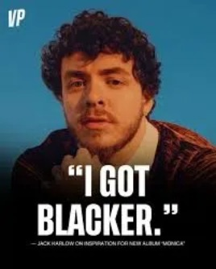
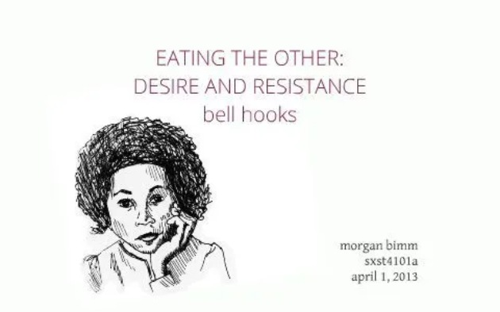
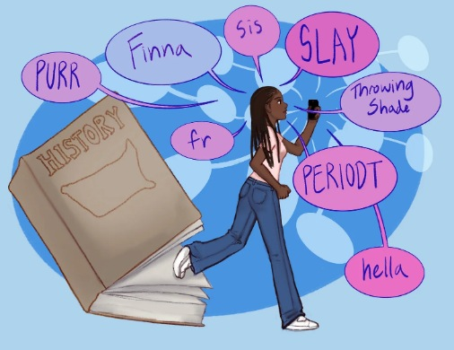
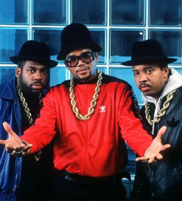
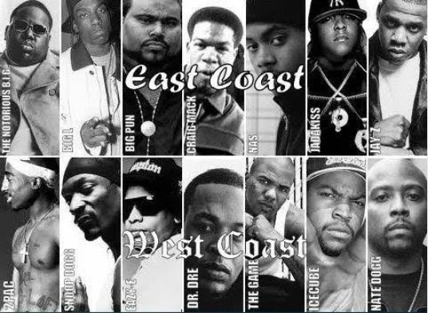
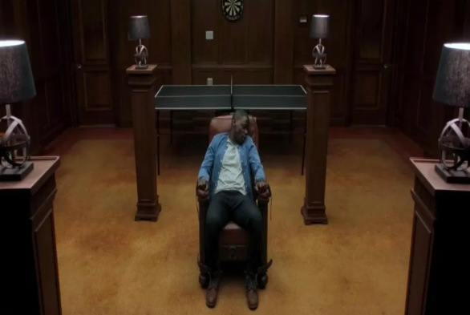
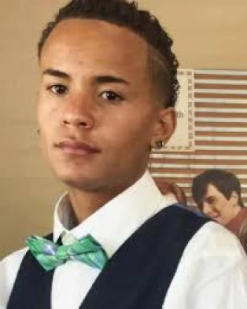

When asked about his shift in musical style, Jack Harlow replied by saying that he "became blacker".

I couldn't help but violently cringe when I watched this clip.

But why would he say that? Why does he want to be Black so badly? Why do white artists want to be black?

To help explain this dynamic, let's break down legendary feminist bell hooks' "Eating the Other" to explain how white consumers will commodify blackness by framing it as primitive and pleasurable in order to soothe their own numbness and their own identity crisis. Rap music is widely considered as black music. It is often seen as an authentic representation of the black experience. Yet if it's truly authentic, why is it that the largest consumers of rap music happen to be white youth? Why is it that white executives continue to dominate its production and distribution?

This contradiction can be understood in the concept of imperialist nostalgia: the longing for cultures which dominant groups have historically oppressed as a way to hide the colonial guilt of destroying their cultures. And so what happens is that black cultures are reimagined not as something that is shaped by struggle and resistance, but more so as something that is exciting, authentic, even freeing.

Central to this whole idea is primitivism, the idea of constructing non-white cultures as more sensual, more alive, more free, more natural, etc. So for a handful of white youth who feel dissatisfied with white culture and whiteness, they will turn to black culture and blackness as a site of escape to experience more meaning and intense feeling. This, however, is not neutral and it can quickly turn to a sort of cultural tourism, or spectacle. If several people are not having enough contact with black communities, their only contact being rap music, this can create a very stereotypical portrayal of what blackness really is. In turn, such behavior can lead into more consumption and more desire without actual accountability.

This is rather difficult because even people who were trying to find themselves artistically[^1] are often forced to systemically and economically meet such portrayals.

I think of Michel Foucault's understanding of pleasure from "The Use of Pleasure" in which he says

> *the kind of pleasure I would consider as the real pleasure would be so deep, so intense, so overwhelming that I couldn't survive it. I would die.*

So for dominant culture to experience the heightened epitome of pleasure is to simply "become" black. The rap industry portrays black bodies as sites of both danger and desire from lyrics which depict their lives on the edge and engaging in dangerous activity. But even if these are real life experiences for those specific black people, the consumer will view it as a way for them to vicariously experience this heightened pleasure without actually having to be black, without having to undergo years and years of violence and marginalization.[^2]

White consumers' fascination for the violence, crime, and rebellion talked about in the rap industry fuels the market for a very narrow and exaggerated version of blackness. Whiteness is seen as a default "normal" whereas blackness is the fetishized dangerous other. The logic behind "eating the other" is powerfully seen in *Get Out*, where the Armitage family is literally selling black bodies in a way to offer physical and sensory enhancements.

The desire to inhabit Chris's body reflects the same belief that blackness offers something more powerful yet also vitally pleasurable. The person who gets to wear Chris's body reaps the privilege of only wearing the "best" parts without actually experiencing the structural barriers which continue to oppress black people today. By sensationalizing their bodies, they're able to feel as though they're more alive...they feel able to consume the other.

Here's the caveat. When rap music is constantly desired for being dangerous, it can easily transform into anti-blackness. This connection is evident in the 2019 killing of Elijah Alamin, a black teenager who was murdered by a white man for listening to rap music. (Said white man claimed to feel very threatened by people who listen to it.) So we can really see those stereotypes of danger and violence perpetuated in the rap industry, but at the same time harm black communities when desired and fetishized.

Now that we understand the concept of eating the other, imperialist nostalgia, and the ways in which the commodification and fetishization of black culture shows up in the rap industry, I think we can understand better why Jack Harlow's statement was so harmful. To say that "he's become blacker" reflects a broader and cultural logic in which blackness is treated as a concept which can be easily adopted, consumed, and culturally appropriated. Just how it's a fundamental inequality within the rap industry as a whole, white artists have the freedom to explore different genres[^3] while actually profiting off of different black cultural forms. Black artists are constrained by expectations to perform narrow, exaggerated, and stereotypical forms of blackness in order to achieve commercial success.

While Jack Harlow can pick out the parts of blackness which he deems more pleasurably artistic, he has the privilege to distance himself from systemic discrimination, surveillance, and violence that shapes the lives of black artists every single day.

## Sources

hooks, b. (1992). Eating the other: Desire and resistance. In *Black looks: Race and representation* (pp. 21–39). South End Press.

Rosaldo, Renato. "Imperialist Nostalgia." *Culture and Truth: The Remaking of Social Analysis*, Beacon Press, 1989, pp. 68–87, *University of Pennsylvania*, [web.english.upenn.edu/~cavitch/pdf-library/Rosaldo_Imperialist.pdf](https://web.english.upenn.edu/~cavitch/pdf-library/Rosaldo_Imperialist.pdf).

Thompson, Jaylen. "The Consumption of Rap Music at a Predominantly White Institution." *Davidson History Journal*, 2021, *Davidson Local*, [dhj.davidsonlocal.org/wp-content/uploads/2021/05/JaylenFinal.pdf](https://dhj.davidsonlocal.org/wp-content/uploads/2021/05/JaylenFinal.pdf).

[^1]: Example: RUN DMC, came from middle-class families; one had college-educated parents and the other was a self-proclaimed "mama's boy" from a Catholic school background. Not many listeners knew this since "RUN DMC" was a commodity to be sculpted and packaged in order to be sold to the public.

[^2]: they can maintain their social position while consuming Black culture that is seen as close to death, and where death is held as the peak moment of pleasure.

[^3]: Post Malone and Machine Gun Kelly come to mind
